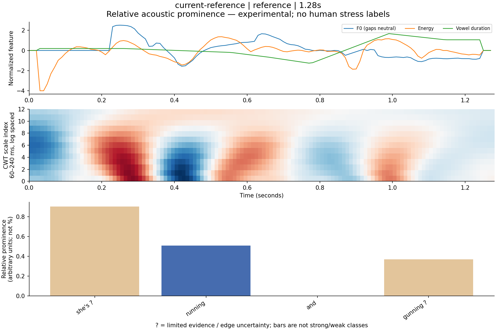
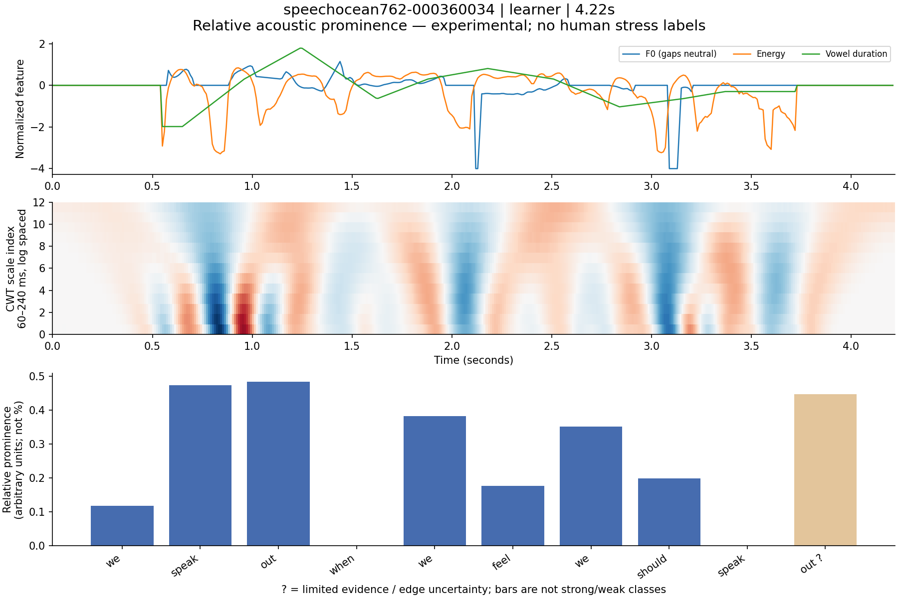

# Rhythm CWT 离线实验 · 2026-10-16

现有 MFA、10ms F0 和能量可以生成连续的**相对声学突出程度**，不需要新增大模型。本机真人短句的 CWT 增量中位数约 **13–17ms**；性能可行，但尚无人工重音金标，不能给出准确率或将它称为已验证的真实重音识别。

本次没有修改生产 API、worker、数据库、缓存版本、用户录音 ASR、60%／85% 门槛、原音获取或线上展示。新脚本没有被应用代码导入，PyWavelets/绘图依赖仅安装在被 Git 忽略的实验环境。

## 你指定的最新 Take

从当前 Chrome 练习内容查到最新 Take：北京时间 **2026-10-15 17:24:58**，句子为 “She's running and gunning.”。该 Take 已有词检查为 **0/4，below_60**；当时没有运行 Rhythm，也没有保存回放音频。分析输入已清理。前一条 17/18（94.4%）的 Take 同样未保存原音、分析输入已清理。

因此没有重跑这些 Take、没有绕过门槛，也没有从逐词五点音高/时长汇总伪造完整能量曲线。**最新用户 Take 与 Reference 的配对效果未能测量。** 本次实际运行的是其绑定的真实 Reference，以及明确分开的公开真人 Reference / 学习者样本。公开学习者不是用户本人，也不是当前 Reference 的同句配对。

私有查询快照和实验输入保存在本机 `.cache/cwt-experiment/`，未放入报告或 Git；没有上传新的音频、改变云端记录或启动分析 worker。没有为已清理输入绕过保留政策下载旧对象。

## 方法和输出

独立实现位于 [rhythm_cwt.py](../../../apps/api/scripts/rhythm_cwt.py)。借鉴 [Wavelet Prosody Toolkit](https://github.com/asuni/wavelet_prosody_toolkit) 将 F0、能量和时长组合后进行多尺度分析的思路，使用 **PyWavelets 1.8.0** 的 `cwt(..., "mexh", method="fft")`。未引入或复制 Toolkit 整套代码，没有再提取一遍音高；也没有声称复现其 LOMA 算法。

1. 检查完整 10ms 帧和句子相对时间、MFA 单词/音素边界及既有音质结果。缺帧/非均匀时间轴拒绝；低音量、严重削波、语音不足退出。
2. 每段录音单独归一化：F0 转相对中位数的半音，能量去中位数。标准差下限分别为 2 半音、3dB，避免把近乎平直的信号强行放大。不是最大值归一化。
3. F0 只桥接不超过 150ms 且位于词覆盖内的间隙；长间隙不补造音高，保留缺失掩码。中性占位仍可能造成局部 CWT 影响，需要人工验证。
4. 根据 MFA 元音音素边界生成时长信号，使用对数时长、句内相对归一化和 0.25 标准差下限。ARPA 重音数字不作为声学重音证据。不同元音的固有时长、句尾延长尚未建模。
5. 13 个对数等距 Mexican-hat 尺度，尺度参数 60–240ms，采样仍为 10ms。反射补边，按尺度平方根校正系数，F0／能量／元音时长权重为 0.4／0.4／0.2。这是固定实验参数，尚未由标注数据学习或校准。
6. 将尺度平均响应在词内元音区域的正峰值作为连续突出量。**单位任意、没有强/弱分类阈值、不是概率或正确率**；0 不等于“确定没有重音”。未做跨录音标量校准，不能直接把两段数值相减当学习成绩。
7. 音高覆盖不足、无元音/音素覆盖不足、尺度边缘影响等标记 `uncertain`；无法定位时值为 null。仍输出既有 VAD 停顿、MFA 词间间隔和元音中心间距。MFA 词间间隔不等于真实静音，CWT 没有在本轮确证短语边界。

每个词还保留音高覆盖率、有效音高中位数、平均帧能量、元音时长，以及突出峰值处三个特征的贡献，便于核对原因。

## 实际效果与限制

当前 Reference 长 **1.28s**，输出如下。数值仅在该录音内阅读：

| 词 | 相对突出程度 | 证据状态 |
|---|---:|---|
| she's | 0.904 | 不确定：句首边缘 |
| running | 0.508 | 算法估计 |
| and | 0.000 | 算法估计；不是“无重音”结论 |
| gunning | 0.368 | 不确定：句尾边缘 |



当前结果不能直接解释为 “she's 就是真实主重音”：它靠近片段边缘，词首低能量和快速 F0 变化也会影响响应。仅有四个词的上下文尤其不足，不能用这个样本定阈值。

公开学习者 `speechocean762-000360034`：“WE SPEAK OUT WHEN WE FEEL WE SHOULD SPEAK OUT”，实际 ASR **10/10**。第一个 `speak` 和 `out` 的候选值分别为 **0.473、0.484**；末尾 `out` 为 **0.447**，但音高覆盖不足，标为不确定。第二个 `speak` 接近 0 也不能判为发音错误。



另外两个公开学习者均 **6/6**，已生成各自图表。另一个样本 `010270117` 只有 **4/5（80%）**，按原规则跳过 Rhythm，不进入本轮 CWT 耗时统计。

敏感性检查揭示了还不能上线的原因：

- 当前 Reference 移除时长特征、改用 0.5/0.5 的 F0/能量权重时，`gunning` 从 0.368 降至 0.187；排名和相对幅度受特征权重影响。
- 公共 Reference “Will we ever forget it” 中，完整模型最高是 `forget`，移除时长特征后最高变为 `will`。不能凭“看起来像合理单词”证明识别效果。
- 公开学习者 `000360036` 的 `with` 也获得较高突出量；功能词可以被强调，也可能受到拖长/音高测量影响，没有人工标注不能断言对错。
- 整段能量减 12dB、整体 F0 乘 1.4，六条真人样本的输出变化在浮点误差内。这验证归一化稳定性，不能证明抗噪、抗 AGC 或 L2 重音准确性。
- 无人工重音/突出程度金标，无同句用户配对，未做盲听评审。**accuracy=null、release_ready=false**。本轮结果只证明可计算、可解释、成本低，尚未证明真实重音识别质量。

## 实测新增耗时

设备：Intel Core i5-8279U @ 2.40GHz，macOS 15.7.9，CPU，Python 3.13.11、NumPy 2.2.6、PyWavelets 1.8.0。各输入 **100 次**，顺序执行。本机仍可能有其他应用负载，原始结果含最大值，不能把 P95 当最坏保证。

计时包含字典转数组、归一化、三路 CWT、词聚合及结果转列表；不包含上传、下载、JSON 输入读取、ASR、MFA、特征提取、绘图、磁盘写入和浏览器显示。它测的是**复用现有特征时的增量**。

| 输入 | 时长 | 中位数 | P95 |
|---|---:|---:|---:|
| 当前真实 Reference | 1.28s | 13.2ms | 17.7ms |
| CMU BDL Reference | 3.37s | 17.4ms | 21.6ms |
| CMU SLT Reference | 1.49s | 13.1ms | 19.6ms |
| 公开学习者 000360034 | 4.22s | 17.2ms | 20.5ms |
| 公开学习者 000360036 | 2.96s | 13.1ms | 16.3ms |
| 公开学习者 010270131 | 2.47s | 12.9ms | 15.2ms |
| 重复特征，**仅计时** | 8.44s | 26.5ms | 35.6ms |
| 重复特征，**仅计时** | 29.54s | 78.5ms | 170.5ms |

最后两行是同一 4.22s 特征重复 2/7 次构造的负载，不能作为长句真人识别效果。29.54s 负载最大值约 435ms；CMU SLT 也出现约 175ms 的离群值。

新 Python 进程启动、导入依赖、读取 JSON 并计算上述全部 8 个输入，5 次测量中位数 **497ms**，P95 **504ms**。这是“整批冷进程耗时”，不是单条录音耗时；worker 若未来常驻导入，不应每条再启动这个脚本。

当前 Reference 的本地实验缓存读取（含完整输入键计算、磁盘读取及解析）中位数 **2.2ms**，P95 **3.4ms**。另外两条 Reference 中位数约 2.5/5.0ms。首次计算后复用缓存不再执行 CWT；计时中的重复计算是为采样，实际缓存路径只算一次。

这次为公开学习者准备现有特征时，实际旧流程耗时如下，均为单次观察，**不能当稳定延迟分布**：

| 学习者样本 | ASR/词检查 | VAD/F0/能量 | MFA | 新增 CWT 中位数 |
|---|---:|---:|---:|---:|
| 000360034 | 10.38s | 0.83s | 21.45s | 0.017s |
| 000360036 | 4.48s | 0.35s | 21.30s | 0.013s |
| 010270131 | 11.12s | 0.69s | 22.60s | 0.013s |

MFA 启动检查按实验准备进程一次执行（约 8–10s），不在 CWT 或每条录音处理路径里。这里没有更改 worker 启动逻辑。这些数据支持“CWT 不是主要耗时”，不支持“端到端上传到页面已经优化了多少秒”的结论。

## 保存完整曲线与 Reference 缓存

本轮离线准备脚本已经保存完整 10ms `time_sec/f0_hz/energy_dbfs`、MFA words/phones、音质、engine 身份和词检查，便于复算；**线上新 Take 的完整能量持久化尚未改动**，遵守本次“不改线上流程”的范围。

三个学习者的完整帧 JSON 约 **17.5–29.5KB**；gzip 后约 **4.6–7.5KB**，对应 2.47–4.22 秒。这是本样本实际大小，不是完整新数据库记录的开销。

离线 Reference 缓存包含精确身份、输入摘要、算法实现摘要和依赖版本，命中不重算；真实 Reference 私有输入带账号/Reference 身份，缓存文件仅本机可读。没有改应用的 Reference 复用模块。

若以后批准接入生产，应在现有 `>=85%` 用户声学计算后、原始音频清理前，保存完整帧检查点；Reference 在既有结果旁缓存同版本连续突出量。复用已有分析授权，沿用账号隔离、删除/过期语义，按匹配词索引比较。不重传、不重提 F0、不重跑 MFA。仅有历史词汇总且原音已清理的 Take 标为无法补算。

## 复现与验证

- [准备脚本](../../../apps/api/scripts/prepare_rhythm_cwt.py)：只读取指定的本地公开种子，校验音频哈希，复用现有 ASR/门槛/音质/MFA，保存完整曲线，不连接业务 API/数据库。
- [CWT 与计时脚本](../../../apps/api/scripts/benchmark_rhythm_cwt.py)、[完整数值结果](results.json)、[隔离环境依赖锁定](requirements.txt)。
- [12 项 CWT 测试](../../../apps/api/tests/test_rhythm_cwt_experiment.py)覆盖平直信号不强制突出、增益/整体音高不变性、可控局部峰值、缺音高/长间隙、坏对齐/坏音质、FFT/直接卷积一致性、缓存复用/身份及输入失效。
- 加上原有词门槛和比较测试，共 **33 passed**。未改生产代码，因此未重跑全站构建或浏览器评分流程。

从仓库根目录复现已保存输入：

```bash
uv venv --python apps/api/.venv/bin/python .cache/cwt-experiment/.venv
uv pip install --python .cache/cwt-experiment/.venv/bin/python -r design/benchmarks/rhythm-cwt-20261016/requirements.txt
PYTHONPATH=apps/api .cache/cwt-experiment/.venv/bin/python -m scripts.benchmark_rhythm_cwt .cache/cwt-experiment/inputs.json --output-dir .cache/cwt-experiment/rerun --cache-dir .cache/cwt-experiment/reference-cache --repeats 100
```

私有输入不随 Git 分发。公共种子准备示例（在 `apps/api` 执行；音频按既有种子下载说明准备）：

```bash
.venv/bin/python -m scripts.prepare_rhythm_cwt --manifest benchmarks/acoustics/v1/public_seed/manifest.json --audio-root /path/to/public-seed --output-dir /path/to/new-features --sample-id speechocean762-000360034
```

基准脚本输入为 JSON 数组，每项含 `id`、`role`、`alignment`、`measurements`；准备文件可直接作为数组元素。私有结果应使用私有输出目录。公开语料许可与来源继续见 [种子 manifest](../../../apps/api/benchmarks/acoustics/v1/public_seed/manifest.json) 和 [许可记录](../../../apps/api/benchmarks/acoustics/v1/public_seed/LICENSES.json)，仅作实验，未训练模型。

下一步应收集一组保留音频/完整帧的同句 Reference–Take，由人工独立标注连续突出程度与不确定词；先检查一致性、排序和低音高重音/句尾延长等失败模式，再校准特征权重与任何展示阈值。
