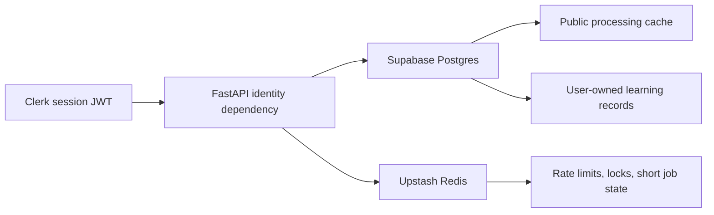
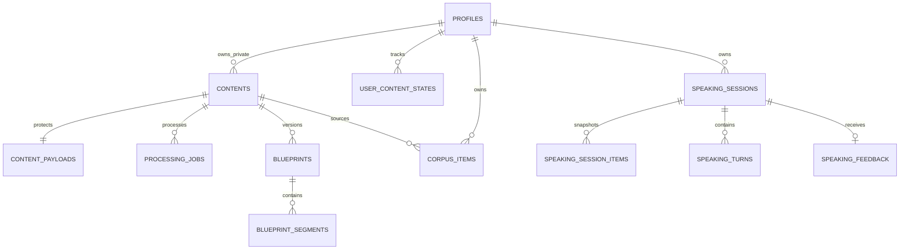

# Libitu Data Architecture

```yaml
meta:
  contentType: Reference
  status: active
  updated: 2026-09-09
```

This document defines the persistence, identity, and cache boundaries for Libitu. The executable relational schema is the ordered set under `supabase/migrations`.

## Provider choices

| Concern | Provider | Source of truth |
|---|---|---|
| Relational data | Supabase Postgres | Postgres tables and migrations |
| Authentication | Clerk | Clerk users, credentials, sessions, and JWTs |
| Ephemeral cache | Upstash Redis | Never authoritative; entries may expire or disappear |

Clerk user IDs are stored as `text` and come from the verified JWT `sub` claim. Libitu does not store passwords or Clerk session tokens. Supabase Auth is not the login provider.

## Data boundaries



Supabase stores durable facts:

- Public source metadata, processing jobs, and versioned blueprints
- Private content payloads such as transcript or pasted text in the unexposed `private` schema
- Profiles keyed by Clerk user ID
- User content state, corpus, speaking sessions, turns, and feedback

Planned authenticated practice persistence adds learner attempts, versioned assessment evidence, progress/level estimates, recommendation inputs, and optional learner-recording object references. This is an accepted architecture direction, not an implemented schema or API. Raw audio belongs in private encrypted object storage; Postgres stores ownership, purpose, object identity, retention/deletion state, consent record, and analysis versions.

Upstash stores disposable coordination data:

- Rate-limit counters
- Short-lived processing locks keyed by normalized content key and analysis version
- Polling acceleration and idempotency hints
- Temporary job progress that is also recoverable from Postgres

Do not store corpus items, final blueprints, speaking turns, feedback, or account ownership only in Redis.

## Practice media and learning records

The accepted [file-reference target](STAGE_TWO_FILE_REFERENCE_ARCHITECTURE.md) proposes private object storage, durable media jobs, source/reference versions, sentence assets, private attempts, and versioned assessments. None of these new media entities is an implemented migration. Acquisition defaults to the selected practice segment when the permitted source supports it; asset identity includes source/track/text/processing versions and exact source-time mapping. Reuse is permission-scoped. Postgres owns durable job/publication facts; Redis carries recoverable coordination, never the only task record. The initial storage-access design uses FastAPI-verified Clerk identity and object-scoped signed access, without assuming hosted Clerk-to-Storage trust is configured.

Separate source ownership from learner ownership:

- An ordinary YouTube source stores a locator, video ID, permitted metadata, sentence identity/bounds, and Libitu-owned processing versions. Browser-captured YouTube audio must not become a durable reference object without sufficient content and platform rights.
- A licensed source stores provenance and licence scope. Source media supplied directly by the rights holder may produce shared sentence, reference-audio, alignment, and acoustic-feature assets.
- A learner attempt is private and belongs to one verified account. It references a sentence/reference version and may own one learner recording plus derived evidence, feedback, and assessment records.
- Reference audio is content-level and shared; never duplicate it into every learner attempt. Learner recordings are user-level and must never be shared through public blueprint tables.

Keep these purposes independent:

| Purpose | Default direction | Stored result |
|---|---|---|
| Current cloud analysis | Explicitly disclosed when cloud analysis is selected | Temporary input plus versioned result |
| Long-term replay/history | User-controlled for signed-in accounts | Private recording object and attempt link |
| Progress and recommendation | Account feature with visible controls | Derived attempt facts, profile estimates, and recommendation events |
| Model training or human review | Separate opt-in, off by default | Only records covered by that purpose and consent version |

Minimum attempt metadata includes task type, content/sentence/reference IDs and versions, completion time, playback speed, text-visible state, evidence-quality status, analysis/model version, measurements, uncertainty, and deletion state. Self-reported level and assessed level are separate fields. Recommendation inputs must be explainable and removable; playback/save activity is evidence of preference or engagement, not proof of mastery.

Define and enforce separate retention schedules for unfinished uploads, analysis inputs, saved recordings, derived history, operational logs, backups, and licence-expired reference assets. Provide access, export, correction, recording deletion, history deletion, recommendation controls, and account closure. Deletion jobs must cover object storage, database records, derived indexes, processor copies, and documented backup expiry.

The provisional launch market is overseas. Region-specific hosting remains a deployment decision for the actual target countries; mainland-China-specific requirements are outside the current launch plan.

## Ownership model

`contents.visibility` separates public reusable sources from private learner input.

- Public content has no owner and is unique by `normalized_key`.
- Private content requires `owner_user_id` and is unique by owner plus normalized key.
- Transcript and pasted-text payloads are stored in `private.content_payloads`, outside the default Data API schema.
- For YouTube caption-first sources, the existing private `source_text` field holds a JSON envelope with `type: libitu-caption-source-v1` and a validated `caption_track`; `transcript_text` remains readable plain captions. This source-type-specific envelope preserves raw millisecond events without a schema migration. It contains no signed URL, request token or media. Legacy absent/non-JSON source payloads remain readable. Queue content carries the same optional track, and new blueprint documents retain source-bound timing metadata plus a caption fingerprint independently of semantic `analysis_version`.
- The timing-only recovery endpoint checks a completed content cache, video/language identity and unchanged spoken words against both the stored source and semantic blueprint. It updates the private caption envelope through the existing server-only payload RPC, retaining the original transcript text and public content metadata. It refreshes ephemeral source caches but does not rewrite semantic blueprint documents, jobs, corpus snapshots or learner media. Failed or uncertain persistence is reported explicitly and may be retried idempotently; no schema or client database privilege is added.
- Database corpus and speaking records always require a Clerk user ID. Guest corpus remains browser-local until account binding and upload.
- Speaking loadouts snapshot selected language so deleting a corpus item does not rewrite old sessions.

Every exposed table has RLS enabled. Policies compare owned rows against `((select auth.jwt())->>'sub')`, which supports Clerk's Supabase third-party authentication integration and lets Postgres initialize the JWT lookup once per statement. Public content and blueprint rows have read-only anonymous policies; processing-job access and all privileged writes remain behind FastAPI.

## Main relationships



## Request path

Public Stage 1 endpoints accept no identity. Private corpus and speaking endpoints require a Clerk session token in `Authorization: Bearer <token>`. FastAPI verifies the token, validates its authorized party, and derives the owner from `sub`.

The implemented corpus path uses the verified Clerk identity in FastAPI, then a server-only Supabase repository. Its secret key bypasses RLS, so every corpus read, patch, and delete explicitly filters `user_id`; inserts derive ownership from verified identity and verify access to any referenced private source. Profiles are inserted idempotently before corpus writes. Synchronous database calls run in FastAPI's threadpool routes.

Direct client Data API access would need a trusted Clerk token so RLS sees the same claims; that integration remains unverified. Server secrets must never be exposed through `NEXT_PUBLIC_*`, extension code, logs, or API responses.

## Corpus save and merge

- `libitu:corpus:v1` stores a versioned local envelope containing guest records and per-account pending outboxes. It never stores session tokens. Corrupt or unavailable storage produces a visible failure instead of silently overwriting data.
- Record keys derive from source identity, kind, and normalized phrase. On login, a single local write moves guest records into the active account's outbox. Web Locks serialize writes across tabs where supported; identical data is not rewritten, preventing storage-event loops.
- Load the account's cloud list, merge pending entries, and keep cloud edits on conflicts. Upload remaining entries separately; acknowledge each only after success. An interrupted import resumes without resending acknowledged entries. Changing accounts aborts stale responses and leaves the original account's pending data bound to it.
- The server derives a UUID5 from verified user ID and client key. `ON CONFLICT DO NOTHING` plus an owner-scoped read makes repeated uploads idempotent without overwriting edits. Ordinary clients without a merge key still get UUID4 IDs.
- Canonical text, meaning, usage, tags, and slots use typed corpus columns. `source_locator` stores source URL/title, the client key, and a validated learning snapshot (source evidence, CEFR, register, phonology, scenarios, and quality scores).
- Signed-in deletion confirms the remote delete before removing visible/local state. If a previous save timed out, resolve its possible server record before clearing the outbox. Server-side deletion does not remove source content.
- Supabase is authoritative when configured. Only unconfigured inline development/tests use memory; queue mode without a database fails with 503. Database failures never silently fall back to memory.

## Environment variables

The API contract is documented in `apps/api/.env.example`:

- `CLERK_SECRET_KEY`, `CLERK_JWT_KEY`, `CLERK_AUTHORIZED_PARTIES`
- `SUPABASE_URL`, `SUPABASE_PUBLISHABLE_KEY`, `SUPABASE_SECRET_KEY`
- `UPSTASH_REDIS_REST_URL`, `UPSTASH_REDIS_REST_TOKEN`

Production must use real frontend origins in `CLERK_AUTHORIZED_PARTIES`. Upstash and Supabase secret credentials are server-only.

The local FastAPI environment has a verified Upstash REST connection. Queue mode uses a Redis list, TTL-bound content/job/versioned-blueprint state, bounded REST requests, worker heartbeat, pending-job re-enqueue, and per-job processing locks. `pnpm dev` starts the API and worker together; `pnpm --filter @libitu/api worker` remains available for an independent worker process. Redis remains disposable; rate limiting and a durable retry scheduler remain pending.

## Hosted project status

Supabase project `ulrdykwhggcaspylines` is the connected Libitu project. The initial schema, RLS optimization, processing-document, Stage 1 job-observability, and idiom-kind migrations are applied to Postgres 17. Processing jobs persist their stage, queue/start/completion timestamps, and per-stage milliseconds. Previous advisors reported only informational findings for intentional private-schema RLS and unused indexes; the 2026-09-04 advisor recheck encountered a transport failure.

`apps/api/app/integrations/supabase_repository.py` writes content, jobs, blueprint documents, private transcript payloads, and private corpus with the server-only Supabase secret key. Processing persistence was verified with a queued DeepSeek blueprint on 2026-09-01. `speaking_repository.py` uses server-only, security-invoker RPCs to create/recover owner-scoped loadout settings and ordered language snapshots atomically. Client speaking-table privileges are revoked; FastAPI remains the identity boundary. Owner/client submission IDs deduplicate retries and reject changed payloads, while deleting source corpus sets the reference null without changing saved text. Real speaking turns and feedback persistence remain planned. See [the loadout contract](LOADOUT_IMPLEMENTATION.md).

On 2026-09-04, a synthetic live corpus test verified idiom insert/list/update/delete, edit-preserving idempotent insertion, and cross-owner rejection through the server repository, then deleted its test rows/profile. This verifies server-side owner scoping, not direct Clerk-token RLS or a real browser login session.

The hosted Clerk Third-Party Auth connection has been prepared but still requires explicit confirmation in the Supabase dashboard. Until that save is complete, do not claim that Clerk session tokens work directly against the Supabase Data API.

## Migration workflow

The repository migrations are the reviewable source of truth. For future schema changes:

1. Create a timestamped migration with the pinned Supabase CLI.
2. Apply it to a development branch or the connected development project.
3. Run Supabase security and performance advisors.
4. Verify anonymous public reads and cross-user denial for private tables.
5. Generate database types only after the schema is accepted.

The Supabase CLI is installed as a root development dependency. Hosted migration success alone does not prove application persistence: verify the affected repository and account-isolation behavior separately.
