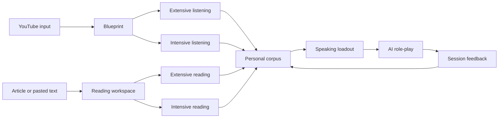

# Build the Libitu MVP experience

```yaml
meta:
  contentType: Reference
  version: 1.1
  status: active
  audience: product, design, engineering, coding agents
  updated: 2026-09-30
```

This specification defines the current Libitu MVP product and interaction model. Use it for product behavior and user experience. Use `MVP_SYSTEM_DESIGN.md` for system boundaries, `BACKEND_SYSTEM_DESIGN.md` for API implementation, and `DESIGN.md` for visual direction.

## Product goal

Libitu helps English learners turn real content into language they can use in work and everyday conversations. The MVP connects three loops: input, personal corpus, and speaking output.

The first complete release must let a learner:

1. Open a public YouTube video from the Chrome extension
2. See a useful blueprint without signing in
3. Save a chunk, idiom, or structure to a personal corpus
4. Select corpus items for a speaking scenario
5. Complete an AI role-play and receive actionable feedback

## Product principles

- **Input must lead to output**: every analysis should suggest language the learner can reuse
- **Structures, idioms, and chunks are different**: structures contain reusable slots, idioms may use a canonical form alongside exact source evidence, and chunks are concrete verbatim expressions
- **Constraint drives practice**: speaking sessions use a small, visible set of selected corpus items
- **Value before login**: Stage 1 works anonymously; login unlocks persistence across devices
- **Public processing is reusable**: cache analysis by normalized content key and analysis version
- **Media use follows purpose and rights**: microphone recordings may use private server analysis/retention with the corresponding opt-in; reference media requires a registered permitted source. Ordinary YouTube playback/capture does not grant upload or reuse rights
- **MVP excludes review scheduling**: spaced repetition and calendar review remain out of scope

## MVP product model

The old fixed five-stage model is no longer the top-level product architecture. The current model has two input paths that converge on one corpus and one speaking path.



The former Stage 1 to Stage 5 names remain useful inside the YouTube intensive flow:

| Legacy stage | Current meaning | MVP priority |
|---|---|---|
| Stage 1: Blueprint | Complete extensive listening experience | Release 1 |
| Stage 2: Shadowing | Intensive listening exercise | After the core loop |
| Stage 3: Loadout | Speaking session setup | Release 1 |
| Stage 4: Sandbox | AI role-play | Release 1 |
| Stage 5: Analytics | Post-session feedback | Release 1, reduced scope |

## Entry points

### YouTube extension entry

The extension adds a Libitu icon button to the lower-right control bar inside the player on supported YouTube watch pages. This button and the browser toolbar action both validate the active video and its language before opening Stage 1. Language support is an explicit expandable list and contains only English (`en`) for the current product. Detection uses YouTube's video/audio language metadata and caption-track metadata; it must not infer content language from the browser interface language or title text. The player button stays disabled while checking and for non-English or unknown languages, with a concise hover reason. A toolbar click on an unsupported language shows an action badge/title and the same reason near the player without opening Stage 1.

For verified English videos, the player button follows the native control dimensions and returns after YouTube redraws its controls. The extension performs a bounded passive caption preflight (waiting for the player's already-started response, not creating a subtitle request) before creating Stage 1; after the bound it opens with the available text/fallback. YouTube in-site navigation must update the entry, rerun language validation, and invalidate captures from the previous video. Repeated clicks reuse the existing Stage 1 tab.

Browser captions use a short-lived handoff rather than URL text. Stage 1 owns content/job creation and retains the resulting IDs for refresh and retry. The extension includes the verified normalized language code in the handoff URL and content request. It has no side panel. Missing browser captions on a supported-language video may use the existing caption-text provider; unavailable captions show an explicit unsupported state in Stage 1.

The extension sends only:

- Video ID, canonical URL, title, and language metadata
- Caption or transcript text that the browser can access
- User selections and derived timing metadata

The extension does not upload audio or video. When captions are unavailable, show an unsupported state instead of attempting server-side media extraction in the MVP.

### Reading entry

The web app accepts an article URL or pasted text. Pasted text is the reliable MVP path. Article URL extraction can ship after its legal, parsing, and failure behavior is defined.

Reading analysis shares the same processing job, blueprint, corpus, and speaking concepts as YouTube analysis.

## Anonymous and signed-in behavior

Anonymous learners can:

- Process supported public content
- View a blueprint
- Choose extensive or intensive mode
- Keep a local Stage 1 snapshot
- Save corpus on this device, surviving reload until local storage is cleared
- Draft a speaking session locally

Signed-in learners can also:

- Save corpus items across devices
- Save content history and progress
- Persist speaking sessions and feedback
- Attach eligible local state after login

Clerk is the selected authentication provider and Supabase Postgres is the selected durable store. Product behavior should still use provider-neutral application language and must not depend on a provider-branded interface.

Login or registration initiated from a reader must return to that exact page, preserving source, content/job identifiers, language, learner level, and any fragment. Switching between login and registration must retain the same return target.

**Shadow entry update (2026-09-19):** Stage 1 and segment selection stay anonymous. Clicking Start shadowing requires login before the recording workspace opens; direct Stage 2 links and refresh enforce the same gate. Login/register returns to the chosen content, segment and sentence without autoplay or a microphone prompt. Canceling login keeps the selected destination with retry and Back to Stage 1 actions. See [implemented persistence flow](STAGE_TWO_PERSISTENCE.md).

## YouTube blueprint experience

### Purpose of the blueprint

The blueprint helps a learner understand the content and identify reusable language in one session. It is the complete extensive listening mode and the entry to intensive listening.

### Required blueprint outputs

- One-paragraph summary
- Four to six logic-flow nodes
- Timestamped key moments
- Useful chunks with meaning and functional tags
- Reusable structures with named slots
- Work or everyday speaking scenarios
- Next actions: save language, continue intensive listening, or start speaking

### Desktop blueprint layout

Use three stable columns:

| Area | Width | Content |
|---|---:|---|
| Logic map | 220 px | Logic nodes and key moments |
| Content | Flexible | Player, summary, and annotated transcript |
| Corpus candidates | 280 px | Chunks, idioms, structures, and saved state |

Keep the player visible while the learner navigates timestamps. Selecting a logic node or transcript timestamp seeks the active YouTube player.

Use Logic Flow as the single navigation region. Chapters summarize topic divisions; logic nodes describe how the speaker develops an argument. The separate Chapters UI is removed because the current chapter labels have no grounded timestamps and duplicate the logic map. The backend field remains for cache compatibility.

### Transcript annotation

Caption-first update (2026-09-13): prefer accessible structured source captions and preserve their millisecond event/segment offsets. Use validated single-word starts for synchronized highlighting; block-only captions keep whole-line highlighting and approximate navigation. Estimated word ends must be identified as estimates; missing, ambiguous or excessively long estimated intervals must not create fabricated word highlighting. A start-to-start interval is not a measured pause. Both stages consume the same finalized sentence sequence and source-token mapping, with no additional practice-unit split.

The player/loading UI is created after a bounded caption preflight. The preflight only waits for an already-observed/player-owned response, then falls back to existing caption paths; it does not reconstruct a signed URL or generate a token, and it never blocks indefinitely. Audio models are independent of this path. Cache source/timing versions, avoid resending unchanged word metadata during semantic streaming, and keep high-frequency highlights local to text. Cached semantic analysis can be reused only when a timing upgrade retains the same spoken text. Caption timing improves available navigation evidence but does not guarantee acoustic word endings or precise IFrame stopping.

Player-response update (2026-09-13): an early page observer may retain a bounded, temporary copy of English JSON3 the YouTube player already fetched. Libitu does not construct or replay signed subtitle requests, generate tokens or start playback to acquire it. On launch it may best-effort use the visible CC/settings controls when an English automatic track is advertised; if it changes the selected track or captions-off state, it records and attempts to restore the prior state after the bounded read. This UI action is private-page best effort and may fail or require a trusted gesture. The launch preflight reads the sanitized cache and waits at most a bounded interval for the observer's page event, then uses the finite DOM/provider fallback without a second polling delay; background timing recovery remains independent. Distinguish an observer missing from an already open page (reload the updated extension, then refresh the source page once), a response not yet observed, an observed track without offsets, response failures and extension communication errors. A retry reads observed data; a failed player request may require the learner to re-enable captions to cause a fresh player request. Neither source refresh nor enabling captions guarantees word timing. Discard old responses across SPA navigation and never expose request credentials.

Show a compact `Word timing unavailable` notice below Stage 1's subtitle controls when current caption text has no words eligible for highlighting, or `Partial word timing` when only some words qualify. In Stage 2, place the same status below the selected sentence and update it on sentence changes. Use the exact word-highlighting validation, not just the presence of a timing field. No text yet produces no premature warning; a streamed partial result describes current evidence and may note that more captions are loading. With usable timing, `Highlight active` off and Sound's hidden-text mode show separate off/hidden explanations. Fully usable, enabled text needs no warning. Notices must not reveal hidden source words, add requests, imply that a refresh guarantees word timing, or prevent ordinary listening/recording.

For a completed YouTube cache with no usable word timing, run a separate recovery attempt after rendering the existing blueprint. Request fresh JSON3 from an already open matching YouTube tab through the extension, independently of the original handoff; do not open a video, start playback, or create another analysis job. Validate the video, language and unchanged source words before saving timing. Show recovery progress/failure beside the timing notice and allow explicit retry; missing extensions/tabs and unusable captions leave basic practice available. Apply new sentence/timing data only when Stage 1 is paused. In an active Stage 2, keep the current practice snapshot and tell the learner to return to Stage 1 to apply the recovered view; do not silently reset a recording, reference session, sentence selection or playback range.

- Show timestamps with tabular numerals
- Use amber highlighting for concrete chunks
- Use teal highlighting for reusable structures
- Show meaning and functional tag in a tooltip or details popover
- Mark the active transcript line without changing layout dimensions
- Support keyboard focus for every interactive annotation
- When auto-scroll is enabled, align the active line only while the video is playing. Pausing or ending playback suspends transcript alignment, but the auto-scroll control remains available so the learner can change the setting before resuming. Manual transcript scrolling temporarily pauses automatic alignment so the learner can read; the auto-scroll control still toggles the setting in this paused state, and turning it back on resumes alignment immediately when playback is active. Explicit timestamp or logic-node navigation resumes alignment once playback starts.
- Keep Logic Flow aligned to playback time. Clicking a transcript row seeks the video and immediately activates the latest logic node at or before that timestamp; normal playback updates the same logic selection as the active transcript advances.
- Before punctuation and analysis, remove only standalone English filler tokens `um`, `uh`, `er`, and `ah`; never remove those character sequences inside another word. Use this same normalized transcript for DeepSeek, evidence validation, and display.
- Preserve reliable source sentence punctuation without running the punctuation model. For captions that need punctuation, send a punctuation-free copy to the local model, attach its sentence marks to the original source words without accepting model casing, then deterministically normalize duplicate or conflicting marks and high-confidence opening discourse markers on every path.
- Merge caption continuations and conservatively repair incomplete punctuation-model candidates using local syntax evidence. Stage 1 and Stage 2 share one finalized sentence sequence; complete long sentences remain intact, with no child practice groups or length-based hard sentence cuts. Processing windows may cross sentence boundaries without changing the displayed units.
- Keep independent sentences separate even when they share one source caption timestamp. Use stable sentence IDs for selection and caption-interpolated start/end metadata for approximate navigation. Confirmed streaming rows cannot be changed by later batches; hold uncertain tails for lookahead and label unresolved end-of-source fragments honestly in metadata.

### Corpus candidates

Each candidate shows:

- Text or structure template
- Type: `chunk`, `idiom`, or `structure`
- Meaning and usage context when available
- Functional tags
- Source title and timestamp when available
- Save or remove action

Blueprint analysis should extract a broad, evidence-grounded candidate pool once per content version. Each candidate records a CEFR reuse level plus naturalness, transferability, and learning-value scores. The visible list is then ranked for the learner's level and limited to a manageable default set; changing level must not trigger another content analysis.

Saving updates immediately after successful local persistence. Anonymous items remain in localStorage. Signed-in saves use authenticated API persistence and show a pending state until the database confirms success. Failed storage or sync is visible and retryable, never presented as a completed cloud save.

Saved shows stored items from the current video, including manual selections and items no longer in the ranked extraction subset. Its cards show a remove/delete icon. Other type tabs show a plus for unsaved items and a check for saved items. Removing a save removes the personal record, not the original extracted candidate.

On login, bind guest saves to that account locally before uploading. Merge by stable source/kind/phrase keys without overwriting existing cloud edits. Remove each pending local entry only after confirmed persistence. Logout or account switching must not expose or import another account's pending records. A cross-video library and saved-item editing UI remain planned.

### Processing states

| State | Required behavior |
|---|---|
| Resolving | Validate source and derive a normalized key |
| Cache hit | Render the saved blueprint without a new analysis job |
| Processing | Show the source video immediately, stream locally formatted sentence-sized subtitles first, then stream validated summary, logic, and corpus previews with a clear status message |
| Ready | Render the complete blueprint and actions |
| Failed | Explain the failure and offer a retry when retry can help |
| Unsupported | Explain that captions or source content are unavailable |

Progressive previews and final results must reuse stable logic and corpus identities. Both phases use the same learner-level filtering and result limit. New evidence may change the visible subset, but finalization must not remount unchanged cards or reset the learner's selected logic node. Leaving or retrying the page cancels the previous client loading chain; a cached ready result does not replay an obsolete preview.

A provider-level retry must not clear already rendered summary, logic, corpus, or transcript. Keep the best validated preview visible and allow a later attempt only to extend it. An explicit learner Retry also keeps the last preview while restarting processing. The browser wait budget must exceed the backend's bounded provider attempts; expiry must not report failure while a healthy worker is still generating.

## Intensive listening

Intensive listening continues from the YouTube blueprint. It is not required for the first end-to-end release.

### Browser-captured reference alignment (2026-09-26)

The browser's existing reference PCM can be aligned locally to its exact sentence and dictionary phoneme targets. Keep this path distinct from server reference ingestion: local word/phoneme alignment and three-layer display do not require a registered file source or an audio upload. Reuse the same captured clip for basic acoustic measurements and alignment, publishing VAD/F0 results first. Show alignment pending, unsupported, unreliable and retry states without blocking playback, recording or basic measurements.

Expose local REF word/phoneme timings even before a learner word result exists. Once the selected saved learner result has matching words and verified learner alignment, display REF/YOU on the same word axis. Preserve each recording's own timing, keep unknown measurements empty, and label local alignment as caption-conditioned without independent content verification. Local target phones and dictionary stress are not recognized speech or correctness verdicts. Do not reuse a server assessment when substituting a local reference. Keep raw reference audio and derived alignment page-local; refresh requires recapture. See [the implementation contract](STAGE_TWO_LOCAL_ALIGNMENT.md).

### Stage 2 target: file-based reference preparation

**Target-flow update (2026-09-09):** Stage 2 now targets file-based reference preparation. The following milestone sections describe the implemented local prototype unless explicitly marked planned. In the proposed target flow, content entry checks source capability/cache; confirming a practice segment starts bounded acquisition and preparation for that segment. Do not download the whole video by default or require a 1× preview. Ready references play from authorized sentence assets; the normal learner flow has no Enable practice audio or Chrome reference-capture authorization. First microphone use still follows browser permission requirements.

Keep the official YouTube player and basic practice available when file references are unsupported. Show that capability before recording. Partial readiness and failures do not block sentence navigation, listening where available, recording, or local replay. Reference layers publish independently; unsupported Sound observations remain unevaluated. Preserve the shared operation area above the layers: place the video first, then a continuous neutral control bar for reference playback, recording/replay and range/loop/speed settings. Use the `DESIGN.md` visual language: a black primary Record/Stop pill, warm-gray Play reference pill, white bordered Replay mine pill, light shadows, 44 px interaction targets, visible keyboard focus and restrained 150 ms feedback. Range and Speed use the shared shadcn/Radix Select pattern with a white 12 px trigger, subtle border/elevation, 13 px medium text and a consistent chevron. Its portal menu uses the same warm-neutral surfaces, clearly marks the selected item, manages focus and keyboard navigation, supports typeahead, and exposes distinct open, hover, focus and disabled states. Show reference readiness as a compact status row below the controls, collapse explanatory copy under How It Works, and leave failures visible. Desktop may keep the groups on one wrapping row; mobile stacks them in the same task order. Cloud uploads/history and preserving attempts across sentence changes remain planned. See [file-reference architecture](STAGE_TWO_FILE_REFERENCE_ARCHITECTURE.md) for source-dependent range fetching, user states, playback coordination, and migration acceptance.

**Implemented file-source increment (2026-09-22):** When an operator-registered source permits processing for the signed-in account and selected range, Stage 2 automatically prepares a private file reference on the server. Playback does not require capture authorization or 1× listening. Current/next sentence assets are prefetched; playback, loop, speed and recording stay together above the layers. Sound shows existing rule guidance plus available measured word durations, Rhythm shows measured timing/pauses and Melody shows an F0 curve with explicit gaps. Server/local measurements are identified separately, with no new pronunciation grade or automatic comparison. SSE and persisted status recover partial work after refresh; cancel/retry/delete are available. Other sources retain the current local-buffer path. See [runtime and retention boundaries](STAGE_TWO_SERVER_REFERENCE.md).

### Stage 2 Milestone 1: sentence navigation and playback

Enter from the completed blueprint's segment picker. The readiness screen reports the selected segment and actual available sentence count; it must not simulate completion of phonology, pitch, or recording work.

Each segment exposes a numbered, clickable sentence directory and a focused sentence with Previous/Next controls. Disable Previous on the first sentence and Next on the last. Directory buttons support standard Tab/Enter navigation plus Up/Down/Home/End with visible focus. During segment playback, indicate the sentence being heard separately from the learner's selected practice sentence.

Entering Stage 2 or selecting a sentence pauses and positions the player. Play/Pause is an independent action. The Range control chooses Sentence or Segment, and one Loop toggle applies to that range; changing range pauses and positions the player at its start. A paused player never starts merely because it is at the end of a loop. Loop off plays once and pauses at the range end. Speed options reflect the embedded player's supported rates, and the control displays the rate the player actually accepted. Sentence, range, and speed changes retain the same embedded player.

Stage 2 consumes the same finalized sentence text, identity, and boundaries as Stage 1; it does not split versioned transcript rows again. Source segments end on shared sentence boundaries. Entirely legacy responses without this metadata retain compatible navigation estimates. Without word alignment, sentence times are approximate and must be labelled as such. Learners can select Segment to hear context around an uncertain boundary. Missing sentence text retains segment playback and explains why sentence navigation is unavailable.

The existing content/job URL carries the selected segment and versioned sentence ID. Refresh restores this selection in a paused state; a stale sentence ID selects the first available sentence, while a missing segment returns to Stage 1. Returning to the picker or Stage 1 clears the Stage 2 URL selection and releases the player. On narrow screens, controls precede the sentence directory without horizontal page overflow.

Milestone 1 contains no microphone capture, acoustic detector, pronunciation score, or inferred sound annotation.

### Stage 2 Milestone 2: local sentence recording

**Persistence update (2026-09-19):** the milestone's temporary take still drives immediate local replay/analysis. Completed takes now also create account-owned practice records. Learners may explicitly retain new recordings for private later replay using an off-by-default checkbox, with the choice fixed at recording start. Saved history survives sentence changes and refresh; failed/pending saves remain page-local with visible retry and an unload warning. The paragraphs below describe the local recorder resource lifetime, not deletion of acknowledged cloud records. History offers separate Delete saved audio and Delete practice record controls. No training/human review or cloud analysis is enabled. See [contract and failure boundaries](STAGE_TWO_PERSISTENCE.md).

Below the practice playback controls, show a Your voice panel for the selected sentence. Record sentence requests microphone access only after the learner clicks it. While permission is pending, show the waiting state and Cancel; do not trap navigation behind an unanswered browser permission prompt. Without sentence text, explain why recording is unavailable while keeping segment playback usable.

Recording pauses the reference player and any previous take. Show a duration timer, Stop recording, and Cancel recording. Stop releases the microphone and waits for encoding to finish before making the take replayable. A take stops automatically after 60 seconds. Replay/Pause, Record again, and Delete operate on the current sentence's take. Reference and recorded playback are mutually exclusive, including native reference-player actions during capture; nothing resumes automatically after recording ends.

Keep one take in page memory for the current sentence. A failed or cancelled replacement retains the previous successful take. A sentence change cancels unfinished capture and clears the take; a range change cancels capture while retaining a completed take for the same sentence. Hiding the tab cancels pending or unfinished recording and pauses playback. Returning to Stage 1, leaving Stage 2, page exit, or refresh clears recording resources. The panel states these retention rules in plain language. Late permission grants and recorder events must never start recording or attach a take to another sentence.

Handle denied permission, no microphone, unsupported recording, interrupted devices, empty/failed recordings, and replay failure with a visible recovery message. Never display a score or invented acoustic feedback in this milestone. Audio stays on the learner's device and is not written to the database or browser storage. Local microphone capability does not establish browser access to the YouTube reference audio needed for subsequent comparison.

### Stage 2 Milestone 3: local reference and acoustic comparison

**Current local-flow update (2026-09-13):** the main Stage 1/2 path now uses an explicitly enabled v3 buffered reference session above both stages. Stage 1 normal 1× listening accumulates bounded valid PCM intervals. The segment preparation page reports text/coverage/analysis separately and offers visible 1× preparation for missing ranges; entering Shadow remains available. The same source session and bounded analysis cache survive stage/segment/sentence navigation. User recording/replay suspends reference preparation; refresh/source change ends the session. JSON3 positions remain caption evidence, not phoneme alignment. See [the implemented flow](STAGE_ONE_BUFFERED_REFERENCE.md). The v2 per-sentence details below describe the retained legacy path, not the main-page default; cloud processing and the file-source target remain unimplemented.

The Reference audio panel offers Enable practice audio for the current practice. The learner enables it, then invokes the updated Libitu extension from Chrome's toolbar on the same Stage 2 tab once. Chrome 116 or newer is required. Enabling opens the audio connection without starting playback or encoding a recording. Thereafter, normal Play sentence at 1× automatically prepares a missing reference, starting the recorder before playback. A fresh native player Play action at the sentence boundary can do the same; selecting a sentence or changing settings must never start playback. After successful capture, Loop on continues normal listening without recapturing the same cached sentence. This is preparation during listening, not audio preprocessing at video ingestion.

Allow sentences up to 60 seconds. Validate the initial position and continuous playback clock; reject a seek, rate change, mid-sentence buffering, early pause, hidden tab, missed deadline, or invalid capture payload. Microphone Record and Replay remain available and cancel unfinished reference capture before they start. Range/loop/speed controls are temporarily disabled during reference preparation; sentence navigation and Pause remain available. Clip failure/cancellation keeps the audio session enabled, with explicit Play available to retry. Never turn microphone/replay audio into a reference.

Switching sentences cancels an unfinished clip while retaining the audio session and cached reference results. Keep up to 20 results in page memory, keyed by content, source URL, sentence ID, time boundaries and analysis version. Returning to a cached sentence uses its results immediately without new encoding or inference. Release raw reference bytes after analysis; bounded temporary bytes may support a failed-analysis retry for up to 60 seconds. Leaving Stage 2, changing content/segment, page exit or refresh closes the session and clears reference audio/features. Hiding the tab cancels unfinished capture and pauses playback; the connection remains subject to its heartbeat lease and a 30-minute maximum. Expired/disconnected sessions visibly require re-enabling. Chrome capture permission comes from the user's extension invocation. Missing extension support shows a recovery message and does not prevent local microphone recording.

Analyze each completed local recording asynchronously, with visible loading/error/retry states. Load pinned speech-model and runtime assets from the app's own origin on first use; no Whisper, cloud speech API or additional API key is required. Silero V5 detects speech regions and Pitchy estimates fundamental frequency. Display speaking span (first to last detected speech), count and duration of internal pauses of at least 200 ms, and the 90th–10th percentile pitch range. Center each pitch contour on that speaker's median in semitones; leave unreliable or unvoiced frames blank. Show speech regions on separate normalized timelines. The display must state that equal horizontal positions do not imply matching words.

Missing reference permits user-only measurements. Silence, clips under 500 ms, or fewer than 400 ms of detected speech prevent timing comparison. Pitch needs at least 200 ms of reliable estimates covering at least 15% of detected speech; insufficient pitch may leave timing usable. Use the actual quality result consistently in tables and charts. Failure to load the speech model must not silently substitute an energy threshold or generated output. Display descriptive differences, with no overall grade or pronunciation score.

Reference boundaries and trim offsets remain approximate browser/caption timing. The learner should start after any advertisement has ended. This milestone does not verify spoken text, identify advertisements, isolate speakers, detect Sound phenomena, infer lexical stress, or establish learning-quality thresholds. Audio and features remain temporary browser memory with no upload or persistence. See `STAGE_TWO_ACOUSTICS.md` for implementation, operational setup and verification boundaries.

### Stage 2 three-layer practice workspace

Present Sound, Rhythm and Melody as three distinct tabs, defaulting to Sound. Match the layer structure of `design/prototypes/toneflow_stage2_three_layer.html`: synchronized layer shortcuts above the left sentence directory, a central canvas for the selected layer, and a right-side layer focus. On narrow screens the focus follows its canvas. Keep sentence navigation above a shared Listen and record area, followed by the three-layer workspace. On desktop, place the original video on the left with Play/Pause, Range, Loop and Speed directly underneath; place Enable practice audio and microphone Record/Stop/Replay beside it on the right. On narrow screens, stack video, playback controls, reference setup and microphone controls before the analysis tabs. Keep the entire operation area mounted independently of layer selection.

Use an accessible tab list with a selected tab, associated tab panels and roving keyboard focus. Left/Right wrap between the three tabs; Home/End select the first/last. A left-side shortcut selects its layer and scrolls the workspace into view. Changing a layer preserves the current sentence, playback, active recording, Sound filters/selection/revealed hints and analysis results. Keep inactive panels mounted but hidden. Layer selection must not seek, start or stop audio, fetch the same guide again, or launch a second analysis of the same recording.

Rhythm leads with sentence text and a “Word stress · Dictionary guide” section. Show one dot per syllable: large dark amber for primary, medium amber for secondary, small light amber for unstressed. All dots are solid; single-syllable words use the same dictionary stress scale. Missing/conflicting patterns use a dash. Share Sound's dictionary request/cache. These are lexical hints, not observations of the speaker's emphasis.

Below it, “Phrases & pauses” shows reference text split at reliably placeable, acoustically detected gaps ≥200 ms, with vertical bars and durations. Convert MFA's segment times to sentence times; identify caption positions as approximate. Caption end estimates never establish silence. Unmatched/ambiguous reference pauses retain sentence-audio-relative times; learner pauses use recording-relative times until learner alignment exists. Never stretch reference text across learner audio or mark pauses correct/incorrect without evaluated evidence. Insufficient/missing analysis retains the text without invented pauses.

Use compact REF phrase rows with thin 18px pause bars and small duration labels, following the prototype. Rhythm retains speaking-span and internal-pause totals below the text; remove the redundant “Rhythm · speech and pauses” timeline. Melody displays pitch range and median-relative contours. Both read shared analysis state; usable timing remains available when pitch is insufficient. Show actionable empty states, not sample curves or scores. Actual sentence emphasis, nuclear stress and learner word-level alignment remain unevaluated.

### Stage 2 Milestone 4: Sound suggestions and evidence

Show a Sound guide for the selected finalized sentence. Load the guide independently from playback and recording; use the sentence identity to fetch server-owned text. The initial General American baseline uses a pinned pronunciation dictionary and deterministic rules. Display linking, weak form, flap, assimilation and elision as possible readings, with an exact highlighted occurrence, dictionary-to-possible sound change, explanation and conditions. These are conditional suggestions, not a required accent or proof that either speaker used the change.

Allow filtering by phenomenon and selecting a suggestion with native, keyboard-accessible buttons. Do not start playback or recording when a filter or suggestion changes. Expose dictionary coverage and unknown/multiple pronunciations; do not guess pronunciations for unknown words. An empty result means the current rules found no suggestion, not that connected speech is absent. Dictionary lexical stress must not be presented as sentence stress.

Render sentence word cards with dictionary IPA, original token text and color-coded conditional phenomenon badges. Selecting a word or source occurrence shows its possible phone change, source text, explanation and conditions in the right-side focus. Preserve the original full sentence and its exact occurrence highlight when text is visible. Dictionary alternatives remain alternatives, and an unavailable pronunciation stays explicit.

Offer Hide text, individual word reveal and Reveal all for listening practice. Hide text covers each word and its IPA, and hides sentence copies, candidate source labels, dictionary details and the selected suggestion that would disclose it. While Sound is selected, also conceal the current practice prompt and selected sentence-directory entry. A covered word button has an accessible positional label and reveals that word on activation. Reveal all restores all text. Switching layers preserves this Sound practice state; selecting a different sentence resets hidden text and revealed-word hints. Hiding or revealing text must not control playback or recording.

Keep Reference and Your voice evidence separate. M4a shows No recording or Not evaluated with the relevant explanation, including when the M3 timing/pitch analysis succeeds. M4b can display realized phenomena only after independent word/phoneme alignment, audio-quality checks, and validation of the individual detector. Never manufacture pass/fail marks, sound scores or realized phonemes from rule candidates, caption timestamps, VAD continuity or matching pitch curves.

The offline benchmark foundation (2026-09-13) provides sample/result contracts, licensed development audio, annotation instructions and target-level evaluation tools. It changes no learner UI and does not complete M4b: all initial seed phenomenon labels remain pending. Rule candidates, human labels and each speaker's acoustic observations have separate provenance; low evidence is explicit abstention, and physical measurements have no fabricated confidence or pronunciation grade. See [the benchmark boundary](STAGE_TWO_ACOUSTIC_BENCHMARK.md).

Changing sentences hides the previous guide immediately, cancels pending requests and rejects late/mismatched responses. Keep up to 20 source/text/version-bound guides within the practice; leave/refresh clears the browser cache. Show loading, failure and Retry sound guide without blocking listening or microphone recording. The API accepts no audio and adds no learner-data persistence. See `STAGE_TWO_SOUND.md` for the exact implemented rules and the remaining detector gate.

### Production practice persistence and reference sources

Basic account-owned practice records and optional private learner recordings are implemented as of 2026-09-19. Retained recordings stay until the learner deletes them, with an explicit choice for each new take. Local acoustic measurements remain transient. Persisted assessments, progress profiles, level estimates, personalized recommendations, full export/account closure and production retention/deletion jobs remain planned. Current recording metadata must not be described as a validated assessment.

Present three purposes independently: upload for the current analysis, retain the recording for later playback, and permit use for model training or human quality review. Explain the data used, retention, deletion, processor, and result impact for each purpose. Model training and human review require a separate opt-in and default to off. Deleting an optional recording should retain valid derived history when possible. Never use voice for identity recognition or authentication as part of pronunciation practice.

Each stored attempt records learner ownership, content and sentence identity, reference version, task type, completion time, playback speed, whether text was visible, evidence quality, measurements, assessment/model versions, and uncertainty. Self-reported level and assessed level are separate. Current Silero/Pitchy timing and pitch evidence cannot produce a CEFR level; level estimation requires broader validated evidence from comprehension, vocabulary/grammar use, independent production, pronunciation/intelligibility, and transfer to unseen tasks.

Ordinary YouTube practice uses the official embedded player and stores a source locator, video ID, sentence identity and bounds, plus learner-owned recordings/results where permitted. Do not upload or retain browser-captured YouTube reference audio as a server asset without sufficient content and platform rights. Browser-local capture is an implemented experiment and is not, by itself, evidence of production permission. Caption and metadata acquisition also require an approved source and retention policy.

Rights-cleared reference content uses a separate catalogue. Obtain the source media and captions directly from the rights holder under terms covering commercial teaching, hosting, excerpting, audio processing, derivative features, territories, duration, and applicable third-party material. Process each licensed source once and store one shared reference clip and feature set per sentence; learner attempts reference that asset rather than copying it into each user's history. Record provenance, licence scope, takedown status, and processing version.

The provisional launch market is overseas. Mainland-China-specific deployment and compliance are outside the current launch scope. Before launch, apply the rules of each actual target market and publish controls for access, export, correction, deletion, retention, recommendation preferences, and account closure.

### Required intensive exercises

- Segment loop with playback speed control
- Sentence-level meaning and structure breakdown
- Shadowing with browser microphone permission
- Local pitch comparison when a reference contour is available in the browser
- Save selected chunks, idioms, and structures to the same corpus

Pitch scores describe prosody only. Feedback must not present pitch similarity as meaning, grammar, or overall speaking quality.

The current prototype processes microphone audio locally. Production may offer authenticated cloud analysis and optional recording retention under the purpose-specific controls above. Derived exercise results may be saved independently when they remain valid without the original recording.

## Reading workspace

The reading workspace is a first-class input path. It can ship after the first YouTube-to-speaking loop, but its data model must remain compatible from the start.

### Required reading outputs

- Article or passage summary
- Paragraph logic map
- Key vocabulary, chunks, and reusable structures
- Sentence-level explanation in intensive mode
- User rewrite field for selected sentences
- Corpus save actions
- Suggested speaking scenarios

Reading has no playback controls or timestamps. Use paragraph and sentence positions as source references.

## Personal corpus

The corpus is the shared bridge between input and output. A corpus item remains linked to its source, but learners can reuse it across content and sessions.

### Corpus item fields

| Field | Requirement |
|---|---|
| `id` | Stable identifier |
| `kind` | `chunk`, `idiom`, or `structure` |
| `text` | Original expression or template |
| `meaning` | Learner-facing explanation |
| `source_text` | Exact source evidence used for transcript matching |
| `level` | Minimum productive CEFR level from `A1` through `C2` |
| Quality scores | Naturalness, transferability, and learning value on a 1-5 scale |
| `usage_context` | Register, intent, or situation |
| `tags` | Functional tags such as `hedging` or `contrast` |
| `slots` | Named placeholders for a structure |
| `content_id` | Optional source content reference |
| Source locator | Timestamp or text position when available |
| `analysis_detail` | Optional persisted selection context plus complete explanation and syntax analysis |

### Corpus actions

Learners can list, filter, create, edit, and delete items. Filters should support type, functional tag, source, and recency when persistence is implemented.

Transcript selection cards are transient by default: clicking outside closes the card, while clicking or editing inside keeps it open. A top-right pin toggle keeps the card open across outside clicks; toggling it off restores outside dismissal. A new transcript selection always destroys the previous card, even if pinned, and opens a fresh unpinned card with an empty note and the explanation tab. Late responses from a destroyed card must never update or close its replacement.

Clicking the body of an extracted or saved corpus card opens a modal with the full explanation, syntax analysis, exact selected text, current source sentence, adjacent context, and timestamp when available. Saving/removing remains a separate icon action and must not open the modal. Unsaved candidates may request analysis on first open and cache it only for the current page; viewing alone must never add an item to the corpus. A save made after that request includes the cached detail. Saved items persist the complete detail locally or in the authenticated corpus record. For a legacy saved item with no detail, first open requests AI analysis from its stored source evidence and writes the result back; subsequent opens use the persisted result.

When a learner selects text in the transcript, Libitu should treat the exact selection as the learner's point of confusion and primary explanation target. On mouseup, show a compact analysis card and send the selected text plus the current, previous, and next subtitle lines for context. A short or grammatically dependent phrase is not automatically incomplete: keep the learner's boundary by default, and recommend a larger exact subtitle span only when the selection has an objectively broken lexical or syntactic edge. Do not show a boundary-status message when the selection is already complete; show the suggested unit and reason only for `needs_expansion`. The default view is explanation because learners usually first need a concise context-specific meaning and discourse function. The syntax view remains available for both phrases and sentences; it should identify a phrase's internal structure and sentence role, or give a seven-module sentence analysis covering syntax, grammatical function, logic, information hierarchy, wording, style and usage scenarios, and direct/natural translations. Reusable slot patterns remain a separate product action. If a reusable pattern is saved from syntax analysis, save it as `structure`. If the model is unavailable, label the result as a fallback and do not fabricate a meaning, IPA, or boundary completion.

Deleting a corpus item must not delete its source content or old session transcript. Old sessions may retain a snapshot of selected language.

## Speaking loadout

The loadout limits active language so the learner can focus during role-play.

### Speaking setup fields

- Scenario type: workplace or everyday life
- Specific goal stated as an outcome
- Difficulty
- Feedback level
- Optional logic template
- Up to three structures
- Up to five expressions, with chunks and idioms sharing the same slots

At least one saved corpus item is required in total. The learner may start with fewer than the maximum: structures are optional (0–3), expressions are optional (0–5), and the logic template is optional. The interface must explain selection limits before the learner reaches them. Loadout is directly accessible from Stage 1 or Stage 2; Shadow completion is not a prerequisite.

Anonymous learners can keep a browser-local draft. On login, the draft binds to that account; an existing account draft must be preserved unless the learner explicitly adopts the incoming guest draft. Account-bound drafts never transfer on logout or account switching. Starting a mission requires login and confirmed account-owned corpus records. Creation snapshots the selected language and settings, is idempotent across retries, and supports authenticated recovery after refresh. The current delivery scope ends at the saved session preparation page; real role-play remains a separate increment. See [the loadout contract](LOADOUT_IMPLEMENTATION.md).

## AI role-play

The role-play keeps the scenario and selected language visible. The AI stays in character and creates natural opportunities to use the loadout.

Each turn response can include:

- AI message
- Detected corpus items
- Brief turn feedback
- Logic-stage progress
- Optional next-turn hint

The 2026-09-30 user decision includes real-time voice in the first Stage 4 delivery: continuous listening, automatic turn-taking and interrupting the AI. Text input remains available in the same conversation. This supersedes the earlier text-only MVP scope. Implementation is still pending; see [the design and implementation proposal](STAGE_FOUR_IMPLEMENTATION_PLAN.md).

Hints should appear after a learner struggles, not after every turn. A hint names one selected item and suggests an intent, without writing the learner's complete response.

## Session feedback

The first release uses four dimensions:

| Dimension | Meaning |
|---|---|
| Task fit | Whether the learner achieved the scenario goal |
| Transfer | Whether selected chunks and structures were used appropriately |
| Scenario fit | Whether tone and register fit the situation |
| Naturalness | Whether the learner's English sounded idiomatic in context |

Show evidence for every score. Evidence can include triggered items, relevant turns, and up to three original-to-refactored examples.

Do not show a fluency score until its inputs and calculation are defined. Avoid presenting language-model judgments as objective measurements.

## Visual system

Libitu is a focused learning tool. It should feel quiet, precise, and suitable for repeated use.

### Core visual tokens

| Role | Token or value |
|---|---|
| Primary background | `#ffffff` |
| Secondary background | `#f7f6f2` |
| Page background | `#eeecea` |
| Primary text | `#1a1a1a` |
| Secondary text | `#5f5e5a` |
| Border | `rgba(0, 0, 0, 0.10)` |
| Active | Purple ramp |
| Success and structures | Teal ramp |
| Chunks and hints | Amber ramp |
| Recording and errors | Red ramp |

The implementation source is `packages/ui/src/tokens.css`. Update the token file and this table together when a semantic color changes.

### Component rules

- Keep application cards at an 8 px radius unless a modal needs more separation
- Use icons for familiar tool actions and provide tooltips for unfamiliar icons
- Avoid cards nested inside cards
- Keep controls and labels stable across loading, saved, and error states
- Use sentence case for interface labels
- Preserve visible keyboard focus and a minimum 44 px touch target on compact screens
- Do not rely on color alone for selected, successful, or failed states

### Responsive behavior

Desktop is the first implementation target. At widths below 1024 px, replace the three-column blueprint with one content column plus drawers or tabs for logic and corpus. Do not compress all three columns until text becomes unreadable.

## Accessibility and content requirements

- Meet WCAG 2.2 AA contrast for text and controls
- Support keyboard operation for tabs, annotations, save actions, playback controls, and dialogs
- Add visible labels for icon-only controls through accessible names and tooltips
- Respect reduced-motion preferences
- Preserve transcript and role-play text at browser zoom up to 200 percent
- Use encouraging, specific feedback; never equate an accent with low ability

## Product success criteria

Instrument these events after the core loop works:

- Blueprint reached `ready`
- First corpus item saved
- Speaking session started
- Speaking session completed
- Selected corpus item used in a session
- Learner returns to the same or a new source

The first product validation question is whether learners complete the path from real input to speaking output. Do not optimize retention mechanics before this path is reliable.

## MVP exclusions

- Spaced repetition and review schedules
- Native mobile application
- Server-side YouTube audio or video processing
- Automatic processing of videos without accessible captions
- Cross-content recommendations
- Social sharing, leaderboards, and public profiles
- Production billing and subscription flows

## Source of truth and precedence

When documents disagree, use this order:

1. `DECISIONS.MD` for accepted product and architecture decisions
2. This document for current product behavior and interaction requirements
3. `MVP_SYSTEM_DESIGN.md` for system boundaries and data flow
4. `BACKEND_SYSTEM_DESIGN.md` for implemented and planned API behavior
5. `DESIGN.md` for visual inspiration
6. Current code for implementation status

Update the affected documents in the same change when a decision alters product behavior, API contracts, data ownership, privacy, or the development sequence.

## Open decisions

- Caption acquisition policy for YouTube sources
- Article URL extraction scope and supported publishers
- Language-model provider, structured-output schema, cost limit, and retry policy
- Anonymous-to-account state merge rules
- Session transcript and derived feedback retention periods

## Stage 2 saved learner analysis — implemented 2026-09-22

After an account/browser opt-in, new recordings upload for asynchronous analysis while practice continues. This choice is independent of retaining audio for later replay. Save content-check outcomes, aligned word durations/pauses and relative pitch; restore results when selecting a historical take or refreshing. Pair REF/YOU word measurements only after both content and alignment gates pass against the same sentence. Show recognized text and withhold comparison on mismatches/uncertainty. Never treat these measurements as observed stress or correctness scores. Keep existing dictionary-stress dots and reference pause displays separate from historical take measurements.

Offer task status, retry where original input remains, cancellation and deletion. Temporary input is cleaned after completion/review or 24-hour expiry by a running worker; saved results remain until deletion. Pending uploads remain page-local. Server references require registered permitted files; unavailable references do not block learner-only measurements. See [complete contract](STAGE_TWO_PRACTICE_ANALYSIS.md).


## Stage 2 paired comparison increment — implemented 2026-09-23

Sound, Rhythm and Melody now share the prototype’s paired Reference / Your recording layout for one saved take. Sound publishes measured vowel timing and candidate consonant–vowel boundary pauses, with separate experimental resemblance scores; eight unvalidated realization checks stay unscored. Rhythm keeps solid amber dictionary stress dots, word durations and text-positioned pause bars. Melody overlays relative pitch on one word axis, preserving gaps. No actual IPA, observed sentence stress, overall Sound grade or pronunciation correctness is inferred. The right panel shows versioned experimental scores and coverage; missing evidence remains empty. Old results stay readable; new evidence requires a new recording. Revoked references hide nested assessments too. See [formulas, compatibility, verification and pending detectors](STAGE_TWO_SOUND_COMPARISON.md). This completes the initial F5 measurement/UI increment, not the validated detector milestone.

**Workspace result visibility (2026-09-24):** Show the selected recording's analysis alongside Reference in all three layers. Restore saved results independently of the choice to analyze new recordings; that choice controls new uploads only. A completed save selects its exact take unless the learner has since chosen another result. History refreshes preserve explicit selection, and save completion refreshes an already selected analysis even when its ID is unchanged. Cancelling a replacement recording or deleting a different history item keeps the selected evidence. Put result status and layers before the history list. Without a paired reference, retain the learner's own aligned Sound timing, Rhythm and Melody measurements while leaving paired scores empty. File-reference practice also shows both speakers when only local learner analysis is ready: timing/pauses and speaker-relative pitch, with explicit lack of word alignment. No new detector or upload permission is introduced.

## Stage 2 browser reference and three-layer update — 2026-09-29

The current browser-reference path uploads the captured sentence for private server analysis after explicit purpose-specific opt-in. A registered file source is not required. Reuse independently verified reference word prosody and bind it to the learner's saved take; wait for reference preparation without exhausting learner retries. Sound and Rhythm each show only Reference / Your voice rows. Melody overlays both median-normalized pitch curves on one word axis, with full corresponding words and pointer/keyboard/playback highlighting below. Pending local curves indicate sentence-time normalization; missing or unverified word evidence remains empty. Keep the video and practice controls above the three-layer workspace. Sound retains the prototype’s ten phenomenon filters, inline word badges, linking arcs, hover/focus dictionary IPA and legend; selecting a phenomenon highlights its exact text occurrences. Rule suggestions and learner targets remain distinct from measured vowel duration and pauses. Unsupported realization checks remain unevaluated. Remove duplicate central measurement panels and the score sidebar. This supersedes the earlier local-only default and paired-score presentation, while retaining the registered file adapter and local quick previews. General remote acquisition and validated sound/stress detection remain planned. See [implementation, normalization and verification](STAGE_TWO_BROWSER_REFERENCE_SERVER.md).


2026-09-30 layer guidance correction: restore the right-side Layer focus, Feedback and Tip cards for Sound, Rhythm and Melody. Sound guidance follows the selected phenomenon and uses the current sentence’s rule suggestions; conceal mode also hides word-specific sidebar text. Desktop places guidance beside the layer canvas; narrow screens place it below. The video remains above the workspace. Removing the experimental score sidebar did not authorize removing instructional guidance; no illustrative scores or detected-error claims are restored.
