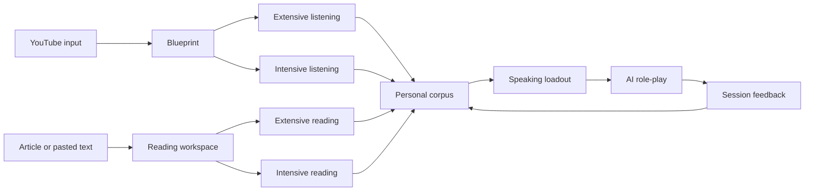

# Build the Libitu MVP experience

```yaml
meta:
  contentType: Reference
  version: 1.1
  status: active
  audience: product, design, engineering, coding agents
  updated: 2026-09-04
```

This specification defines the current Libitu MVP product and interaction model. Use it for product behavior and user experience. Use `MVP_SYSTEM_DESIGN.md` for system boundaries, `BACKEND_SYSTEM_DESIGN.md` for API implementation, and `DESIGN.md` for visual direction.

## Product goal

Libitu helps English learners turn real content into language they can use in work and everyday conversations. The MVP connects three loops: input, personal corpus, and speaking output.

The first complete release must let a learner:

1. Open a public YouTube video from the Chrome extension
2. See a useful blueprint without signing in
3. Save a chunk, idiom, or structure to a personal corpus
4. Select corpus items for a speaking scenario
5. Complete an AI role-play and receive actionable feedback

## Product principles

- **Input must lead to output**: every analysis should suggest language the learner can reuse
- **Structures, idioms, and chunks are different**: structures contain reusable slots, idioms may use a canonical form alongside exact source evidence, and chunks are concrete verbatim expressions
- **Constraint drives practice**: speaking sessions use a small, visible set of selected corpus items
- **Value before login**: Stage 1 works anonymously; login unlocks persistence across devices
- **Public processing is reusable**: cache analysis by normalized content key and analysis version
- **Media stays in the browser**: Libitu servers never receive YouTube audio, video, or microphone recordings
- **MVP excludes review scheduling**: spaced repetition and calendar review remain out of scope

## MVP product model

The old fixed five-stage model is no longer the top-level product architecture. The current model has two input paths that converge on one corpus and one speaking path.



The former Stage 1 to Stage 5 names remain useful inside the YouTube intensive flow:

| Legacy stage | Current meaning | MVP priority |
|---|---|---|
| Stage 1: Blueprint | Complete extensive listening experience | Release 1 |
| Stage 2: Shadowing | Intensive listening exercise | After the core loop |
| Stage 3: Loadout | Speaking session setup | Release 1 |
| Stage 4: Sandbox | AI role-play | Release 1 |
| Stage 5: Analytics | Post-session feedback | Release 1, reduced scope |

## Entry points

### YouTube extension entry

The extension adds a Libitu action to supported YouTube watch pages. It reads page metadata and available captions, then opens the Stage 1 experience.

The extension sends only:

- Video ID, canonical URL, title, and language metadata
- Caption or transcript text that the browser can access
- User selections and derived timing metadata

The extension does not upload audio or video. When captions are unavailable, show an unsupported state instead of attempting server-side media extraction in the MVP.

### Reading entry

The web app accepts an article URL or pasted text. Pasted text is the reliable MVP path. Article URL extraction can ship after its legal, parsing, and failure behavior is defined.

Reading analysis shares the same processing job, blueprint, corpus, and speaking concepts as YouTube analysis.

## Anonymous and signed-in behavior

Anonymous learners can:

- Process supported public content
- View a blueprint
- Choose extensive or intensive mode
- Keep a local Stage 1 snapshot
- Save corpus on this device, surviving reload until local storage is cleared
- Draft a speaking session locally

Signed-in learners can also:

- Save corpus items across devices
- Save content history and progress
- Persist speaking sessions and feedback
- Attach eligible local state after login

Clerk is the selected authentication provider and Supabase Postgres is the selected durable store. Product behavior should still use provider-neutral application language and must not depend on a provider-branded interface.

Login or registration initiated from a reader must return to that exact page, preserving source, content/job identifiers, language, learner level, and any fragment. Switching between login and registration must retain the same return target.

## YouTube blueprint experience

### Purpose of the blueprint

The blueprint helps a learner understand the content and identify reusable language in one session. It is the complete extensive listening mode and the entry to intensive listening.

### Required blueprint outputs

- One-paragraph summary
- Four to six logic-flow nodes
- Timestamped key moments
- Useful chunks with meaning and functional tags
- Reusable structures with named slots
- Work or everyday speaking scenarios
- Next actions: save language, continue intensive listening, or start speaking

### Desktop blueprint layout

Use three stable columns:

| Area | Width | Content |
|---|---:|---|
| Logic map | 220 px | Logic nodes and key moments |
| Content | Flexible | Player, summary, and annotated transcript |
| Corpus candidates | 280 px | Chunks, idioms, structures, and saved state |

Keep the player visible while the learner navigates timestamps. Selecting a logic node or transcript timestamp seeks the active YouTube player.

Use Logic Flow as the single navigation region. Chapters summarize topic divisions; logic nodes describe how the speaker develops an argument. The separate Chapters UI is removed because the current chapter labels have no grounded timestamps and duplicate the logic map. The backend field remains for cache compatibility.

### Transcript annotation

- Show timestamps with tabular numerals
- Use amber highlighting for concrete chunks
- Use teal highlighting for reusable structures
- Show meaning and functional tag in a tooltip or details popover
- Mark the active transcript line without changing layout dimensions
- Support keyboard focus for every interactive annotation

### Corpus candidates

Each candidate shows:

- Text or structure template
- Type: `chunk`, `idiom`, or `structure`
- Meaning and usage context when available
- Functional tags
- Source title and timestamp when available
- Save or remove action

Blueprint analysis should extract a broad, evidence-grounded candidate pool once per content version. Each candidate records a CEFR reuse level plus naturalness, transferability, and learning-value scores. The visible list is then ranked for the learner's level and limited to a manageable default set; changing level must not trigger another content analysis.

Saving updates immediately after successful local persistence. Anonymous items remain in localStorage. Signed-in saves use authenticated API persistence and show a pending state until the database confirms success. Failed storage or sync is visible and retryable, never presented as a completed cloud save.

Saved shows stored items from the current video, including manual selections and items no longer in the ranked extraction subset. Its cards show a remove/delete icon. Other type tabs show a plus for unsaved items and a check for saved items. Removing a save removes the personal record, not the original extracted candidate.

On login, bind guest saves to that account locally before uploading. Merge by stable source/kind/phrase keys without overwriting existing cloud edits. Remove each pending local entry only after confirmed persistence. Logout or account switching must not expose or import another account's pending records. A cross-video library and saved-item editing UI remain planned.

### Processing states

| State | Required behavior |
|---|---|
| Resolving | Validate source and derive a normalized key |
| Cache hit | Render the saved blueprint without a new analysis job |
| Processing | Show the source video immediately, stream locally formatted sentence-sized subtitles first, then stream validated summary, logic, and corpus previews with a clear status message |
| Ready | Render the complete blueprint and actions |
| Failed | Explain the failure and offer a retry when retry can help |
| Unsupported | Explain that captions or source content are unavailable |

Progressive previews and final results must reuse stable logic and corpus identities. Both phases use the same learner-level filtering and result limit. New evidence may change the visible subset, but finalization must not remount unchanged cards or reset the learner's selected logic node. Leaving or retrying the page cancels the previous client loading chain; a cached ready result does not replay an obsolete preview.

## Intensive listening

Intensive listening continues from the YouTube blueprint. It is not required for the first end-to-end release.

### Required intensive exercises

- Segment loop with playback speed control
- Sentence-level meaning and structure breakdown
- Shadowing with browser microphone permission
- Local pitch comparison when a reference contour is available in the browser
- Save selected chunks, idioms, and structures to the same corpus

Pitch scores describe prosody only. Feedback must not present pitch similarity as meaning, grammar, or overall speaking quality.

All microphone processing stays local. Store only derived exercise results when the learner chooses to save progress.

## Reading workspace

The reading workspace is a first-class input path. It can ship after the first YouTube-to-speaking loop, but its data model must remain compatible from the start.

### Required reading outputs

- Article or passage summary
- Paragraph logic map
- Key vocabulary, chunks, and reusable structures
- Sentence-level explanation in intensive mode
- User rewrite field for selected sentences
- Corpus save actions
- Suggested speaking scenarios

Reading has no playback controls or timestamps. Use paragraph and sentence positions as source references.

## Personal corpus

The corpus is the shared bridge between input and output. A corpus item remains linked to its source, but learners can reuse it across content and sessions.

### Corpus item fields

| Field | Requirement |
|---|---|
| `id` | Stable identifier |
| `kind` | `chunk`, `idiom`, or `structure` |
| `text` | Original expression or template |
| `meaning` | Learner-facing explanation |
| `source_text` | Exact source evidence used for transcript matching |
| `level` | Minimum productive CEFR level from `A1` through `C2` |
| Quality scores | Naturalness, transferability, and learning value on a 1-5 scale |
| `usage_context` | Register, intent, or situation |
| `tags` | Functional tags such as `hedging` or `contrast` |
| `slots` | Named placeholders for a structure |
| `content_id` | Optional source content reference |
| Source locator | Timestamp or text position when available |

### Corpus actions

Learners can list, filter, create, edit, and delete items. Filters should support type, functional tag, source, and recency when persistence is implemented.

Transcript selection cards are transient by default: clicking outside closes the card, while clicking or editing inside keeps it open. A top-right pin toggle keeps the card open across outside clicks; toggling it off restores outside dismissal. A new transcript selection always destroys the previous card, even if pinned, and opens a fresh unpinned card with an empty note and the explanation tab. Late responses from a destroyed card must never update or close its replacement.

When a learner selects text in the transcript, Libitu should treat the exact selection as the learner's point of confusion and primary explanation target. On mouseup, show a compact analysis card and send the selected text plus the current, previous, and next subtitle lines for context. A short or grammatically dependent phrase is not automatically incomplete: keep the learner's boundary by default, and recommend a larger exact subtitle span only when the selection has an objectively broken lexical or syntactic edge. Do not show a boundary-status message when the selection is already complete; show the suggested unit and reason only for `needs_expansion`. The default view is explanation because learners usually first need a concise context-specific meaning and discourse function. The syntax view remains available for both phrases and sentences; it should identify a phrase's internal structure and sentence role, or give a seven-module sentence analysis covering syntax, grammatical function, logic, information hierarchy, wording, style and usage scenarios, and direct/natural translations. Reusable slot patterns remain a separate product action. If a reusable pattern is saved from syntax analysis, save it as `structure`. If the model is unavailable, label the result as a fallback and do not fabricate a meaning, IPA, or boundary completion.

Deleting a corpus item must not delete its source content or old session transcript. Old sessions may retain a snapshot of selected language.

## Speaking loadout

The loadout limits active language so the learner can focus during role-play.

### Speaking setup fields

- Scenario type: workplace or everyday life
- Specific goal stated as an outcome
- Difficulty
- Feedback level
- Optional logic template
- Up to three structures
- Up to five chunks

The learner may start with fewer items. The interface must explain selection limits before the learner reaches them.

## AI role-play

The role-play keeps the scenario and selected language visible. The AI stays in character and creates natural opportunities to use the loadout.

Each turn response can include:

- AI message
- Detected corpus items
- Brief turn feedback
- Logic-stage progress
- Optional next-turn hint

Text input is the MVP requirement. Voice input remains a later feature because it introduces speech-to-text, consent, latency, and retention decisions.

Hints should appear after a learner struggles, not after every turn. A hint names one selected item and suggests an intent, without writing the learner's complete response.

## Session feedback

The first release uses four dimensions:

| Dimension | Meaning |
|---|---|
| Task fit | Whether the learner achieved the scenario goal |
| Transfer | Whether selected chunks and structures were used appropriately |
| Scenario fit | Whether tone and register fit the situation |
| Naturalness | Whether the learner's English sounded idiomatic in context |

Show evidence for every score. Evidence can include triggered items, relevant turns, and up to three original-to-refactored examples.

Do not show a fluency score until its inputs and calculation are defined. Avoid presenting language-model judgments as objective measurements.

## Visual system

Libitu is a focused learning tool. It should feel quiet, precise, and suitable for repeated use.

### Core visual tokens

| Role | Token or value |
|---|---|
| Primary background | `#ffffff` |
| Secondary background | `#f7f6f2` |
| Page background | `#eeecea` |
| Primary text | `#1a1a1a` |
| Secondary text | `#5f5e5a` |
| Border | `rgba(0, 0, 0, 0.10)` |
| Active | Purple ramp |
| Success and structures | Teal ramp |
| Chunks and hints | Amber ramp |
| Recording and errors | Red ramp |

The implementation source is `packages/ui/src/tokens.css`. Update the token file and this table together when a semantic color changes.

### Component rules

- Keep application cards at an 8 px radius unless a modal needs more separation
- Use icons for familiar tool actions and provide tooltips for unfamiliar icons
- Avoid cards nested inside cards
- Keep controls and labels stable across loading, saved, and error states
- Use sentence case for interface labels
- Preserve visible keyboard focus and a minimum 44 px touch target on compact screens
- Do not rely on color alone for selected, successful, or failed states

### Responsive behavior

Desktop is the first implementation target. At widths below 1024 px, replace the three-column blueprint with one content column plus drawers or tabs for logic and corpus. Do not compress all three columns until text becomes unreadable.

## Accessibility and content requirements

- Meet WCAG 2.2 AA contrast for text and controls
- Support keyboard operation for tabs, annotations, save actions, playback controls, and dialogs
- Add visible labels for icon-only controls through accessible names and tooltips
- Respect reduced-motion preferences
- Preserve transcript and role-play text at browser zoom up to 200 percent
- Use encouraging, specific feedback; never equate an accent with low ability

## Product success criteria

Instrument these events after the core loop works:

- Blueprint reached `ready`
- First corpus item saved
- Speaking session started
- Speaking session completed
- Selected corpus item used in a session
- Learner returns to the same or a new source

The first product validation question is whether learners complete the path from real input to speaking output. Do not optimize retention mechanics before this path is reliable.

## MVP exclusions

- Spaced repetition and review schedules
- Native mobile application
- Voice input during AI role-play
- Server-side YouTube audio or video processing
- Automatic processing of videos without accessible captions
- Cross-content recommendations
- Social sharing, leaderboards, and public profiles
- Production billing and subscription flows

## Source of truth and precedence

When documents disagree, use this order:

1. `DECISIONS.MD` for accepted product and architecture decisions
2. This document for current product behavior and interaction requirements
3. `MVP_SYSTEM_DESIGN.md` for system boundaries and data flow
4. `BACKEND_SYSTEM_DESIGN.md` for implemented and planned API behavior
5. `DESIGN.md` for visual inspiration
6. Current code for implementation status

Update the affected documents in the same change when a decision alters product behavior, API contracts, data ownership, privacy, or the development sequence.

## Open decisions

- Caption acquisition policy for YouTube sources
- Article URL extraction scope and supported publishers
- Language-model provider, structured-output schema, cost limit, and retry policy
- Anonymous-to-account state merge rules
- Session transcript and derived feedback retention periods
