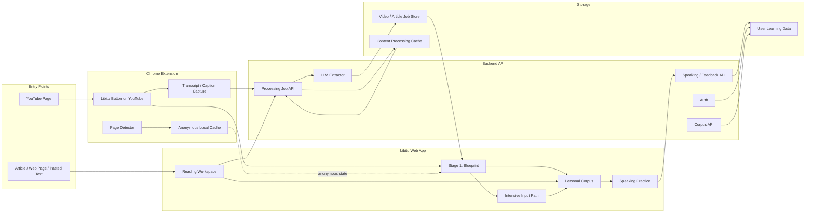
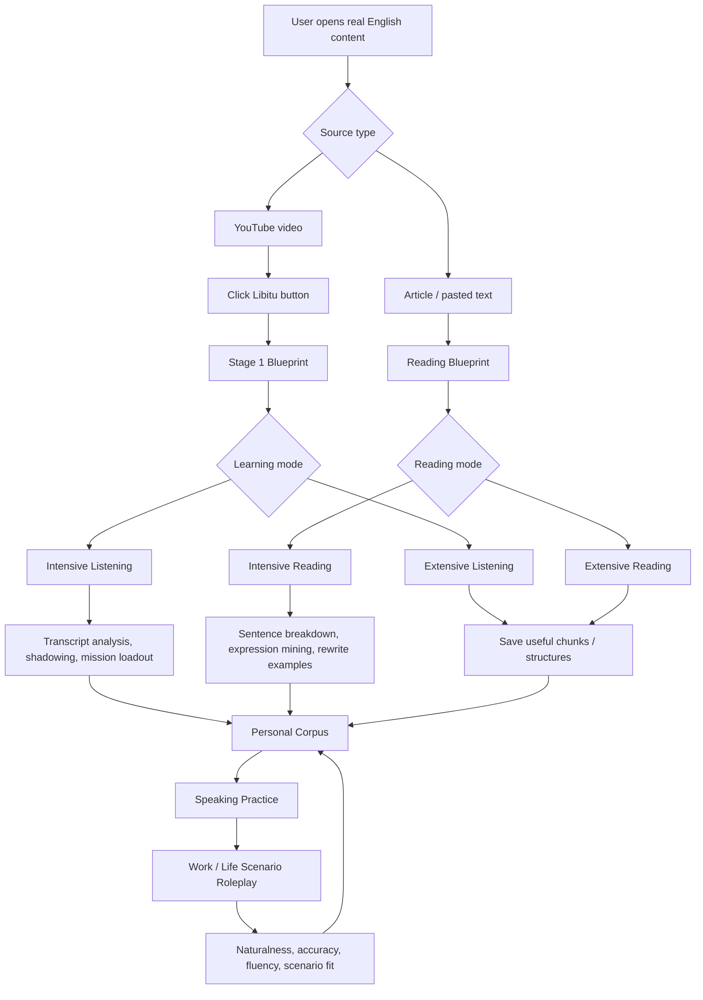
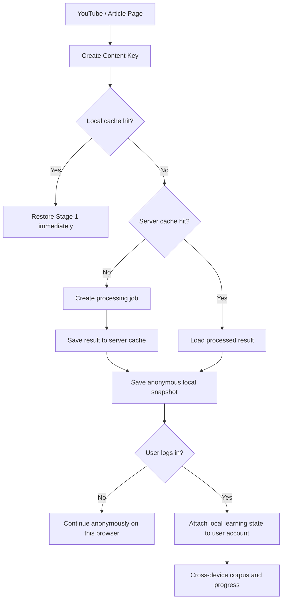
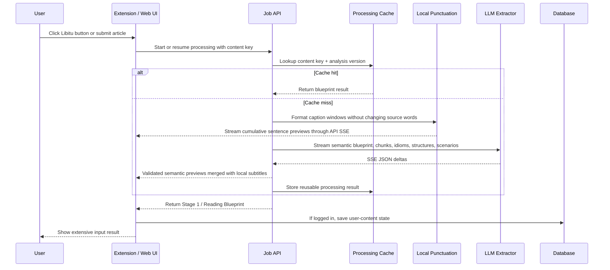
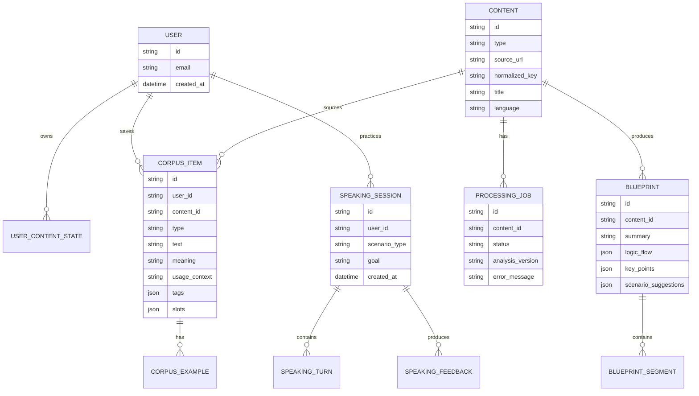
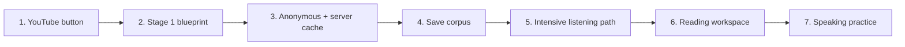

# Libitu MVP System Design

Version 0.1

This document defines the MVP system design for Libitu as a practical English fluency product for work and everyday life. The MVP includes YouTube listening input, reading input, personal corpus collection, intensive/listening modes, speaking output practice, auth-aware persistence, and processing cache. It intentionally excludes spaced review and long-term revision scheduling.

## Product Scope

Libitu helps learners turn real-world English content into usable spoken English.

The MVP has three connected loops:

- Input loop: YouTube listening and article reading.
- Corpus loop: extract, edit, and save reusable expressions and structures.
- Output loop: speak with AI using the saved corpus in practical work/life scenarios.

Out of scope for MVP:

- Spaced repetition.
- Calendar-based review plans.
- Cross-content recommendation engine.
- Full mobile app.
- YouTube audio/video server upload.

## System Overview

## Learning Flow

## MVP Modules

| Module | Purpose | MVP behavior |
|---|---|---|
| YouTube Button | Start learning from a YouTube page | Inject a Libitu button into supported YouTube pages and pass `videoId`, title, URL, and available caption/transcript metadata to the web app. |
| Stage 1 Blueprint | Fast comprehension and extraction | Generate summary, logic flow, key vocabulary, chunks, structures, and practical takeaways. This is the full extensive listening experience. |
| Intensive Listening | Turn video input into active language | Continue from Stage 1 into transcript-level analysis, shadowing, mission setup, and speaking preparation. |
| Reading Workspace | Add article/text-based input | Accept URL or pasted text, produce reading blueprint, sentence-level analysis, and corpus candidates. |
| Personal Corpus | Store useful language | Save concrete chunks, abstract structures, example sentences, source context, tags, and user rewrites. |
| Speaking Practice | Output training | Use selected corpus items in AI roleplay for workplace and everyday scenarios, with practical feedback. |
| Auth & Persistence | Save state without blocking first use | Anonymous users get local cache; logged-in users get cross-device learning history and corpus. |
| Processing Cache | Avoid repeated expensive processing | Cache by normalized content key so refreshes and duplicate videos do not trigger full reprocessing. |

## Auth and State Strategy

Stage 1 should not require login. Forcing login before the learner sees value would add friction.

The MVP should use three layers of state:

### Anonymous state

Use local browser storage for:

- Last opened content.
- Stage 1 result snapshot.
- Selected learning mode.
- Unsaved corpus candidates.
- Temporary speaking session draft.

### Logged-in state

Use backend persistence for:

- Personal corpus.
- Saved video/article history.
- Intensive listening progress.
- Reading workspace progress.
- Speaking sessions and feedback.

### Shared processing cache

Use a backend cache for content-level work that is not user-private:

- YouTube transcript processing result.
- Article extraction result.
- LLM blueprint result by content hash and analysis version.

This prevents a refresh from reprocessing the same content and prevents repeated work when multiple users study the same public video.

## Content Processing Pipeline

## Core Data Model

## Stage Definitions

### Stage 1: Blueprint

This is both the entry stage and the complete extensive listening mode.

Outputs:

- One-paragraph content summary.
- Logic flow or argument map.
- Timestamped key moments for video.
- Useful chunks.
- Reusable sentence structures.
- Work/life scenario mapping.
- Suggested next action: continue intensive listening, save corpus, or start speaking.

### Intensive Listening

Continues after Stage 1.

Outputs:

- Annotated transcript.
- Sentence-level meaning and structure breakdown.
- Shadowing or read-aloud practice.
- User-selected chunks and structures.
- Mission-ready language set for speaking.

### Reading

Reading has its own input path but shares the same corpus and speaking system.

Outputs:

- Article summary.
- Paragraph logic map.
- Sentence-level grammar and expression analysis.
- User rewrites.
- Corpus candidates.

### Speaking Practice

This is the output side of the product.

Inputs:

- Selected corpus items.
- Scenario type: workplace or daily life.
- Difficulty and feedback level.

Outputs:

- AI roleplay conversation.
- Corrections.
- More natural alternatives.
- Missed chance suggestions.
- Optional corpus additions generated from the user's own speech.

## API Boundary

| API | Method | Purpose |
|---|---|---|
| `/api/content/resolve` | `POST` | Normalize YouTube URL, article URL, or pasted text into a content key. |
| `/api/jobs` | `POST` | Start or resume a processing job. |
| `/api/jobs/:id` | `GET` | Poll processing status and result. |
| `/api/blueprints/:contentId` | `GET` | Fetch Stage 1 or reading blueprint. |
| `/api/corpus` | `GET` / `POST` | List and save corpus items. |
| `/api/corpus/:id` | `PATCH` / `DELETE` | Edit or remove corpus items. |
| `/api/speaking/sessions` | `POST` | Start a roleplay session from selected corpus. |
| `/api/speaking/sessions/:id/turns` | `POST` | Submit a user turn and get AI reply plus feedback. |

## Key Product Decisions

1. Stage 1 is available without login.
2. Anonymous users keep state through local browser cache.
3. Login unlocks cross-device corpus, history, and speaking records.
4. Public content processing is cached server-side by normalized content key and analysis version.
5. Extensive listening is Stage 1 only.
6. Intensive listening continues from Stage 1 into deeper input work.
7. Reading is a first-class input source, not a later add-on.
8. Speaking practice is the output side and should always connect back to user-selected corpus.
9. Review and spaced repetition are deliberately excluded from MVP.

## MVP First Release Path

The smallest coherent release is:

YouTube button -> Stage 1 blueprint -> cached state -> save corpus -> speaking practice.

Reading and intensive listening should be designed in the same architecture from day one, but can ship immediately after the YouTube Stage 1 loop if implementation time needs to be controlled.
