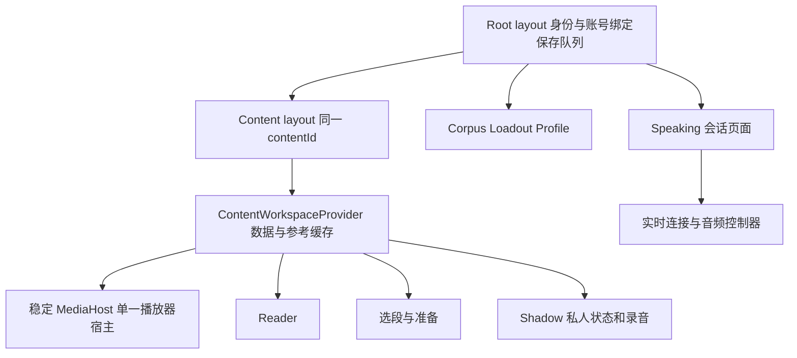
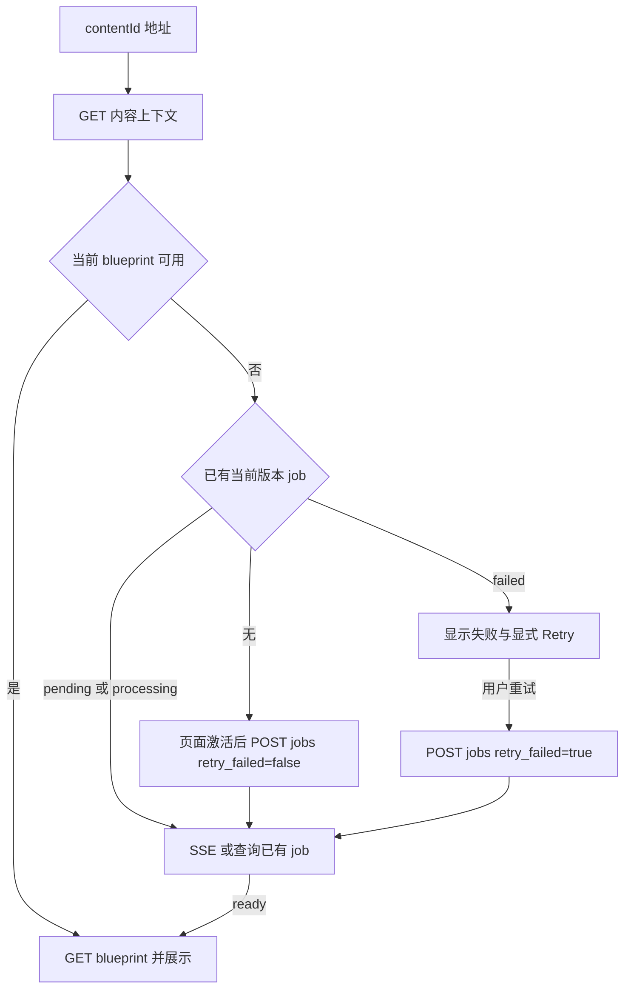

# Libitu 路由与职责架构设计

```yaml
meta:
  contentType: Design proposal
  status: in progress
  updated: 2026-10-10
  implementation: R0–R5 implemented; R4 entry work pulled into R3; live toolbar capture qualification separate
```

本设计把学习内容作为稳定入口，将阅读、选段准备、跟读划为同一内容工作区内的不同任务；口语配置、会话和报告沿用现有地址。前端负责可恢复的位置和交互资源，后端负责内容身份、业务状态和持久任务。2026-10-10 用户明确要求直接更新：不保留旧学习链接、v2/v3 协议或入口开关。

R0–R5 已实现。R3 直接启用 `/practice` 内容路径、主阶段 push 历史和扩展 v4；为避免入口断开，R4 的链接生成、继续学习 v2 与扩展标签复用一并实施。R0–R2 记录描述当时的过渡状态，旧协议和旧根学习入口现已停止启用。当前行为以代码、[PROJECT](../../PROJECT.MD) 及 [DECISIONS](../../DECISIONS.MD) 为准。

## R3 实施记录 — 2026-10-10

- `/practice/import` 只负责匹配字幕 handoff 和 resolve，完成后 replace 到内容地址；接入期间不创建播放器或捕获会话。内容 layout 持有 Provider/MediaHost，Reader、选段、准备、Shadow 从路径/query 派生状态。主要阶段 push、选择 replace、显式返回 replace 到确定目标。
- 首页、语料、历史、Mission 返回和个人继续学习生成新地址；继续学习只读写 owner 绑定的 v2 记录，不迁移 v1。根 query 不启动学习，旧 job 链接不再恢复。
- 扩展 0.2.0 仅启用 v4 bridge/background/offscreen。内容 API 校验来源，Chrome 提供 tab/document，隔离 bridge 生成 nonce；同内容导航保留，完整导航通过 webNavigation/pagehide 释放。能力 ping 不授权，工具栏授权仍必需。默认扩展入口改为 import，规范地址通过已验证的标签映射复用。
- R5 已删除旧 v2 编码器等未引用内部文件；不保留旧协议运行分支。无新增 API 或数据库迁移。
- 浏览器资源验收与真实扩展授权的边界见 TASK；自动化未成功触发 Chrome 的真实工具栏授权，不能把 arm/关闭或合成 PCM 验证视为真实 tabCapture 验收。

## R0 实施记录 — 2026-10-10

- [learning-location.ts](../../apps/web/features/navigation/learning-location.ts) 统一旧根地址的解析与生成，区分首页、无效地址、Reader、Shadow；校验重复参数、来源、标识、级别别名和选段。现有 Stage 2 导航继续使用 replace，不在本阶段改变浏览历史规则。
- [return-location.ts](../../apps/web/features/navigation/return-location.ts) 分开处理学习来源与登录回跳。学习来源移除 job、字幕及 handoff，拒绝跨站和嵌套 returnTo；登录返回保留当前受支持页面的 query/hash。Mission、会话、报告、重试和调整草稿传递同一个来源。
- LoadoutLink 的真实 href 包含来源；不再依赖普通点击事件补参数。页面入口从服务端 searchParams 传递返回位置，避免只在首次挂载时读取。
- 只有 jobId 时先读现有 job API 恢复 contentId。Web 入口不再补演示视频；任务读取、SSE、轮询和最终 blueprint 校验身份。视频来源关联在最终 blueprint 可用时校验，尚不能替代 R1 的内容上下文预校验。
- 新增旧地址 fixtures、URL/返回链和加载器回归测试，以及桌面/移动浏览器导航检查。根 lint/build/test 与导航、报告浏览器用例通过；浏览器使用确定性 fixture，不代表真实 OAuth、YouTube 或扩展混合版本已经验收。

R0 本身没有变更后端接口、数据库或扩展协议，也没有解决内容运行时的资源归属。后端工作见下方 R1 实施记录；播放器/音频资源存活及新路径迁移仍由 R2、R3–R5 完成。

## R1 实施记录 — 2026-10-10

- [content_context.py](../../apps/api/app/services/content_context.py) 提供 `GET /api/content/{content_id}`。只读公开 YouTube 元数据和当前版本摘要；持久存储的可见性优先，不向匿名调用者开放 article/pasted_text，也不加载私有 caption RPC。成功及业务错误响应使用 `no-store`。来源缺失可从合法 normalized key 恢复；来源冲突返回 `source_metadata_unavailable`，依赖故障返回安全的 503。
- [job_service.py](../../apps/api/app/services/job_service.py) 接收 `retry_failed` 与 `expected_attempt_count`。false 不重启 failed；true 仅在 failed 且次数相等时接受一次重试，迟到次数返回当前状态，超前次数返回 409。省略字段保留既有适配器语义。
- `attempt_count` 表示已接受的处理代次：首次创建保留 1，显式或兼容重试保留下一次，worker 启动不重复加一。持久模式以数据库任务为准；[SupabaseRepository](../../apps/api/app/integrations/supabase_repository.py) 使用状态和次数条件 PATCH，处理并发插入的双唯一约束竞争；[processing_queue.py](../../apps/api/app/integrations/processing_queue.py) 使用 Redis Lua 原子更新状态/索引并防止迟到缓存发布回退状态。没有数据库 schema 变更。API 与 blueprint worker 需要一同升级。
- [practice_analysis_service.py](../../apps/api/app/services/practice_analysis_service.py) 接管读取、重试、取消及删除编排；[speaking_lifecycle.py](../../apps/api/app/services/speaking_lifecycle.py) 接管会话结束/删除。持久操作失败照常失败；完成后本地清理或反馈申请失败记录安全代码，保留现有反馈补偿与迟到写隔离。
- 新增共享 TypeScript DTO、[契约 fixture](../../packages/types/fixtures/content-context.json) 和 Web read/ensure adapter。**本阶段没有切换旧 Reader 加载器**：R2 抽取 controller 时接入“先内容读取、再按状态决定 ensure/显式 retry”的完整流程，避免在 R1 同时改动媒体生命周期。
- 根检查通过：810 API、348 Web、118 extension 测试。独立 PostgreSQL（REST 测试适配层）及 fakeredis/lupa 的 Lua 检查通过 32 路并发创建/重试、快速再次失败和迟到缓存更新；见 [验证脚本](../../apps/api/scripts/verify_processing_contract.py)。未执行托管 Supabase/Upstash 部署或付费 provider 调用，现有页面的新流程浏览器验收留到 R2。

## R2 实施记录 — 2026-10-10

- [controller.ts](../../apps/web/features/learning-workspace/controller.ts) 编排只读内容上下文、旧 job 来源核对、流式预览、缺失任务 ensure 与显式失败重试。可用 blueprint 优先于旧 failed job；ready 后 404 只做三次有界读取，不创建分析。丢失 POST 响应时保留同一 `expected_attempt_count`，读取到新失败并再次点击才接受下一次意图；内容切换取消请求并拒绝迟到结果。
- [ContentWorkspaceProvider](../../apps/web/features/learning-workspace/ContentWorkspaceProvider.tsx) 拥有内容状态、字幕时序恢复、参考缓冲和按内容/来源/账号隔离的本地分析缓存。活跃 Shadow 保持原句子快照，暂停 Reader 才应用恢复时序。账号切换重建私人 Shadow 子树、清理参考缓存并释放原账号的捕获授权；公共 blueprint 不重新分析。
- [MediaHost](../../apps/web/features/learning-workspace/MediaHost.tsx) 拥有唯一的 YouTube 实例及实际 DOM 宿主。Reader、准备页和 Shadow 注册显示占位及控制回调，宿主按占位几何定位并按滚动容器裁切；没有更换 portal 容器或移动 iframe。无占位时暂停并隐藏，退出工作区或切换内容才销毁。字幕高亮时钟随当前控制者切换。
- [RouteBridge](../../apps/web/features/learning-workspace/RouteBridge.ts) 处理旧 Shadow query 和浏览器 popstate，同一内容内的后退执行同样的视图清理。选段、准备仍是旧页面的本地步骤，主阶段 push 历史和新路径在 R3 实施。v3 扩展所需的规范来源在媒体启动前写入旧 URL，避免字幕恢复补参触发内容重载。
- 根级 PracticePersistence 的归属不变；Reader 的私人详情和迟到缓存写入增加账号代际隔离。旧 `loadStageOneBlueprint` 仅保留兼容测试入口，实际 Web 学习入口已经使用新 controller。没有新增后端端点、数据库变更或扩展协议。
- 根 lint/build/test 通过（810 API、360 Web、118 extension）；生产构建下的工作区、导航、字幕恢复、录音和参考缓冲浏览器检查通过桌面及 390px。覆盖真实 history、单一 iframe/授权、账号隔离、跨页面保存、迟到授权、实际本地分析及 AudioWorklet；详细边界和 fixture 限制见 [TASK](../../TASK.MD)。

## 设计范围和约束

- 保留 Next.js Web、FastAPI、Chrome 扩展三个部署边界及现有存储、任务基础设施。
- 保留匿名阅读、选段、本地语料和 Loadout 草稿；Shadow、持久会话、私人记录继续需要身份及后端所有权校验。
- 保留句子版本、字幕时序恢复、音频同意、账号隔离、删除防复活与反馈证据规则。
- URL 调整不要求将现有 Stage 名称改成 Learn，也不增加新的练习大厅。文章入口、跨设备继续学习、离线持久上传、微服务拆分均不纳入本次交付。
- 视觉布局保持现状；媒体宿主的结构调整需要浏览器验证，不能用重新挂载播放器换取目录整齐。

## 设计基线和需要解决的问题

下表记录设计时的基线；入口解析与 Mission 返回链已在 R0 修复，后端读取、重试及服务用例已在 R1 实施，内容运行时与媒体宿主已在 R2 实施；新路径和扩展已在 R3 直接更新，旧实现已在 R5 清理。

| 已核对的实现 | 当前边界 | 目标调整 |
|---|---|---|
| [根页面](../../apps/web/app/page.tsx)、[入口判定](../../apps/web/features/landing/entry.ts) | `/` 根据 source/content/job/handoff query 选择 Landing 或 Reader | 根路径承担首页及旧入口适配；正式工作区按内容定位 |
| [StageOneReader](../../apps/web/features/stage-one/components/StageOneReader.tsx) | 同时拥有加载、reader/picker/preparing/shadow、登录与音频缓冲 | 将跨视图职责移入内容工作区；Reader 专注阅读 |
| [Stage 2 location](../../apps/web/features/stage-two/location.ts) | 模式与句子都 replace；组件状态与 URL 手工同步 | URL 决定导航位置，明确 push/replace 规则 |
| [内容加载器](../../apps/web/features/stage-one/api/stage-one-api.ts) | 单独 jobId 可通过入口判定，但只有 contentId 分支才使用 job；缺 source 时有 demo 默认值 | 显式解析入口组合，线上无 demo 回退，校验任务与内容关联 |
| [会话](../../apps/web/features/speaking/ConversationWorkspace.tsx)、[报告](../../apps/web/features/analytics/AnalyticsPage.tsx) | 会话到报告及返回未完整保留 returnTo | 统一构造来源地址，跨会话与报告传递 |
| [根布局](../../apps/web/app/layout.tsx)、[保存 Provider](../../apps/web/features/stage-two/persistence/PracticePersistence.tsx) | 上传和保存已经可跨页面继续 | 保留根级生命周期及账号切换清理 |
| [content router](../../apps/api/app/routers/content.py) | 已有 resolve、caption-timing；没有按 ID 读取内容上下文的 GET | 增加只读内容上下文，支撑未完成分析时的独立深链接 |
| [job service](../../apps/api/app/services/job_service.py) | job ID 按 content 和 analysis version 确定；队列模式 POST 可重启 failed job | 保留 ID 语义，增加显式失败重试意图 |
| [practice analysis router](../../apps/api/app/routers/practice_analysis.py)、[speaking router](../../apps/api/app/routers/speaking.py) | 部分重试、删除和结束流程在 router 中编排 | 收敛到可直接测试的 service 用例 |
| [扩展字幕恢复](../../apps/extension/src/fresh-captions.js)、[缓冲桥](../../apps/extension/src/buffer-bridge.js) | 字幕恢复要求根路径；缓冲按去除 Stage query 后的整条 URL 绑定 | 新旧协议并行，版本化定义内容工作区身份 |

这些是静态代码核对结果。前进后退、跨路径播放器存活及扩展新协议需在实施阶段完成真实浏览器验收。

## 业务对象和身份

| 对象 | 稳定身份与关联 | 权威来源 | 导航用途 |
|---|---|---|---|
| Content | content_id；由服务端规范化来源生成，客户端视作 opaque ID | 内容服务及存储 | 正式学习 URL 的主体 |
| Blueprint | content_id + analysis_version；句子还带 segmentation_version 和时序指纹 | 分析服务 | 页面读取结果，版本不由客户端任意指定 |
| Processing job | 现有 content_id + analysis_version 对应 job ID；attempt_count 表示重试次数 | job service / worker | 临时进度提示，不是内容永久地址 |
| Segment / Sentence | 归属 content 和对应句子快照 | blueprint 及句子契约 | 可恢复的片段、句子选择 |
| Reference | reference_id + owner + 来源/输入/分析身份 | 参考服务 | 从练习查询恢复，不增加顶级页面 |
| Practice attempt | attempt_id + owner；包含录制时的句子快照 | practice service | 私人历史记录；本次不新增详情路由 |
| Speaking session | session_id + owner；保存独立的语言和情境快照 | speaking service | 会话与报告的共同主体 |
| Feedback | session + 冻结输入及 rubric/analysis version | feedback service / worker | 报告页展示服务端结果 |

教学含义：地址选取的是用户想长期访问的对象。任务可以被重试，内容地址保持稳定；删除原语料不能改写已创建会话的语言快照。页面位置、执行次数和持久业务事实分别建模。

新 URL 的 content ID 使用当前服务端生成的 UUID；旧适配器继续按既有契约解析历史标识，交给 API 验证，不在浏览器猜算一个“替代 ID”。失效的句子 ID 不能用于绑定新录音；已保存 attempt 始终显示它自己的历史快照。

## 前端路由契约

### 目标地址

| 地址 | 单一页面任务 | 访问规则 | 刷新和错误行为 |
|---|---|---|---|
| `/` | 产品介绍和新视频输入；旧 query 不启动学习 | 公开 | 无来源保持 Landing；营销参数不启动分析 |
| `/practice/import?sourceUrl=...` | 接入新来源并取得 content ID | 公开 | 保留输入和失败动作；handoff 过期明确提示，不使用 demo |
| `/practice/[contentId]` | 阅读当前内容、提取和保存语料 | 公开；私人语料独立按身份加载 | ID 无效/不存在显示对应错误；处理中显示实际进度 |
| `/practice/[contentId]/segments` | 选择片段 | 公开 | 恢复可选的 segmentId；无选择显示目录 |
| `/practice/[contentId]/segments?segmentId=...&step=prepare` | 准备所选片段 | 公开 | 展示实际覆盖与分析状态；不自动播放或重新授权捕获 |
| `/practice/[contentId]/shadow?segmentId=...&sentenceId=...` | 听录并比较选定句子 | 登录后挂载录音能力 | 登录保持目标；无效片段回 Reader，失效句子选首个有效句 |
| `/corpus` | 语料管理 | 保留 guest/local 和 owner/server 两种模式 | 保留现有筛选能力；本轮不扩张其 URL 协议 |
| `/loadout?returnTo=...` | 配置口语草稿 | 可匿名起草，创建会话需登录 | 保留已有账号绑定草稿及报告导入提示 |
| `/speaking/[sessionId]?returnTo=...` | 进行或回看会话 | 登录及 owner 校验 | 从 workspace 恢复；刷新不自动开启麦克风 |
| `/speaking/[sessionId]/analytics?returnTo=...` | 查看该会话反馈 | 登录及 owner 校验 | 从持久反馈状态恢复，不依赖上一页面已挂载 |
| `/profile`、`/profile/history` | 学习概览与历史 | 登录及 owner 校验 | 保留现有读取、过滤、分页行为 |

正式内容 URL 只允许 `learnerLevel`；旧 `level` 字段不再接受。来源语言由内容上下文决定，不在正式 URL 中另设可覆盖它的语言事实。原有片段 hash 保留，在相应内容完成渲染后应用，不触发播放。

不新增 `/practice` 大厅；首轮若有人访问该裸路径，临时重定向到 `/`。现有 Practice 导航保持新内容入口语义，继续学习保留在个人中心。该选择避免借路由重构增加新的产品页面。

Reader、Shadow 采用独立 path，因为任务、身份门槛和加载形态不同；句子使用 query，因为它是同一跟读工作区内的连续选择。选段与准备共用一条路径，以 step 表达可恢复的流程阶段。Sound/Rhythm/Melody 保留局部视图状态，本次不增加分享语义。

### URL 解析和来源优先级

唯一纯解析模块返回结构化结果，错误也属于结果：`landing | import | reader | segments | shadow | invalid`。使用一次规范化、一次编码的 builder，禁止各 feature 拼接完整地址。

当前入口规则：

1. `/` 始终显示 Landing；已有 root query 不触发 resolve/job 请求。
2. `/practice/import` 要求有效的 YouTube sourceUrl，可携带短期 handoffId/title。匹配字幕在 resolve 前消费，成功后只保留 contentId 与 learnerLevel。
3. 正式路径只接受规范 UUID contentId，来源、语言和标题由内容接口读取；URL 不携带 jobId、sourceUrl、transcriptText、handoffId。
4. segments 的 step=prepare 和 Shadow 要求 segmentId；句子仅属于 Shadow。重复标量、非法编码、越界标识、未知 step/level 报错，不启动业务请求；已失效片段 replace 到 Reader。

正规化只保留属于目标页面的白名单字段及合法 hash。认证处理中保留 SDK 必需的回调数据，待认证完成再清理；不把身份票据、字幕文本、handoff、临时 job 元信息传播到永久地址或日志。

### 浏览器历史和返回来源

| 用户动作 | 历史操作 | 理由 |
|---|---|---|
| 首页提交 → import | push | 返回可继续修改输入 |
| import 完成 → 正式内容地址 | replace | 接入是临时过程，返回不重新消费 handoff |
| Reader → 选段 → 准备 → Shadow | 每个主要阶段 push | 浏览器返回恢复上一步；直接链接不伪造历史 |
| 更改所选片段、Shadow 下一句 | replace | 连续选择不堆积大量历史 |
| 参数修复、过期句子回退、无效选择回退 | replace | 修复当前定位 |
| 会话 → 报告；报告内 Conversation review | push 到明确 href | 直接打开报告也能回到指定会话 |
| 显式 Back to reader / Back to picker | 使用明确目标；复用已知相邻历史，否则 replace | 避免依赖可能属于外站的上一页或形成往返循环 |

内容位置以 URL 为准，不再保留另一套 stageOneView 作为页面身份。route bridge 订阅 pathname/query，包括 popstate；导航意图可先显示 pending，但不能覆盖已提交 URL 的真实含义。切换句子前暂停并处理录音资源，后退导航执行同一清理规则。

returnTo 继续使用兼容字段，但只表示最初来源。统一 builder 将同一个已校验值传过 Loadout → Session → Analytics → Session，以及报告的 retry/adjust；不把当前 speaking/loadout 地址层层嵌入 returnTo。修改键和新标签打开也必须得到完整 href，不能只在普通 onClick 中补参数。

来源只允许站内根入口、有效内容工作区、corpus、profile/history；拒绝协议地址、双斜杠、控制字符、反斜杠和递归 returnTo。旧根学习地址不再作为来源恢复；未消费 handoff 的临时入口不能作为长期来源。非法/缺失来源回 `/`，不依赖 history.length 判断有无站内上一页。

登录回跳使用独立的 auth return 校验器，允许当前会话/报告等完整目标，避免把来源规则误用于登录。切换登录/注册保持同一目标；取消登录保留 Shadow URL 与返回动作。

## 状态和资源生命周期



| 状态或资源 | 拥有者 | 保留范围 | 重置或释放条件 |
|---|---|---|---|
| 当前页面、片段、句子 | URL + 统一 route bridge | 导航、深链接、刷新 | 规范化或用户导航 |
| 内容、blueprint、流式 preview | 内容 controller | 同一 content 工作区 | 内容改变；旧请求被 abort/代际隔离 |
| 活跃练习句子快照 | Shadow controller | 当前练习，包括后台时序恢复 | 明确离开练习后才应用新句子版本 |
| 官方播放器和播放所有权 | 内容 MediaHost | Reader、选段、准备、Shadow 同内容切换 | 离开内容工作区或内容身份变化 |
| 参考捕获会话与分析缓存 | 内容 runtime | 同来源跨上述视图 | 来源/文档变更、授权释放、租约到期等既有条件 |
| 麦克风和本地 take | Shadow recording controller | 按当前句子、range 的既有规则 | 换句/隐藏/退出等触发取消；迟到授权不得重启 |
| 保存与捕获上传 outbox | 根级 PracticePersistence | 任意站内客户端导航 | 完成/取消/账号切换；仍不承诺刷新后离线持久 |
| 私人参考、attempt 和 consent | owner-scoped store/controller | 有效账号与对应输入身份 | 登出/账号变化立即隔离，拒绝旧回调 |
| 口语 WebSocket 与麦克风 | 会话页面 controller | 当前会话页面 | 离开、断线、账号变化释放；离开不等于完成会话 |
| 会话状态和反馈 job | 后端 service/worker | 跨页面、刷新和设备 | 业务结束/删除或任务策略 |

MediaHost 必须是 layout 内稳定的实际组件和 DOM 宿主。只移动 Provider、却在 Reader 和 Shadow 各放一个播放器，无法满足保留实例要求。页面通过命令/订阅控制宿主；布局用同一宿主的样式位置适配，不能通过更换 portal container 或 key 隐式重建它。无播放场景暂停并隐藏；CSS 隐藏不代替释放和暂停策略。

公共 blueprint 缓存按 content、analysis/segmentation version、时序指纹和展示参数区分。私人结果还要包含 owner、输入及 reference 身份。UI 模式不是分析结果的缓存身份。具体声学 key 延用现有精确输入契约，不因路由迁移简化。

共享 layout 仅保证特定客户端导航下的存活；刷新重建内存和扩展文档绑定。公共内容不因登录而重新分析，私人子树按账号重置。后台时序更新继续在暂停的 Reader 应用，不能在 Shadow 内替换当前句子与录音绑定。

## 模块职责和依赖方向

以下是目标文件归属示意；learning-workspace 模块已在 R2 创建，practice 路由与独立 import 入口已在 R3 实施：

```text
apps/web/app/
  page.tsx                         Landing
  practice/import/page.tsx          内容接入
  practice/[contentId]/layout.tsx   内容 runtime 与 MediaHost
  practice/[contentId]/page.tsx     Reader
  practice/[contentId]/segments/page.tsx
  practice/[contentId]/shadow/page.tsx

apps/web/features/navigation/
  learning-location.ts             解析和生成规范内容地址
  return-location.ts               来源与认证回跳的独立策略
apps/web/features/content-entry/
  controller.ts                    handoff、resolve、接入恢复
apps/web/features/learning-workspace/
  ContentWorkspaceProvider.tsx     内容作用域资源
  controller.ts                    读取、预览、时序快照协调
  RouteBridge.ts                  Next 导航与 controller 命令连接
  MediaHost.tsx                    单一播放器实例
```

现有 stage-one 和 stage-two 保留 feature 名称及纯业务辅助，渐进抽取，避免大范围 import 改名。共同 runtime 不反向依赖 Reader 页面。Header、继续学习、历史、Corpus 来源及报告链接全部调用 builder；个人学习位置直接使用 v2，忽略 v1，保留账号切换防继承规则。新格式保存规范内容位置，不再要求 URL 携带 sourceUrl；重开后由服务端恢复元信息。

扩展没有 bundler，因此第一轮不引入共享 npm 包编译链。Web 与扩展各保留适配器，通过同一组纯 JSON 地址/身份契约 fixture 验证一致性；扩展的 Chrome/DOM 能力继续留在 extension。

## 后端接口和业务用例

### API 变更清单

| 接口 | 目标动作 | 兼容策略 |
|---|---|---|
| `GET /api/content/{content_id}` | **新增**只读内容上下文与当前版本处理摘要 | 新客户端先于正式路径使用；已有接口不删除 |
| `POST /api/content/resolve` | 保留创建/解析语义，客户端在用户内容接入时调用 | 核对规范来源、caption 与 content 的关联；不借 GET 执行 resolve |
| `POST /api/jobs` | **增量增加** `retry_failed` 意图和 `expected_attempt_count` 并发条件 | 省略新字段保持旧调用语义；新客户端显式 false，或 true 加读取到的次数 |
| `GET /api/jobs/{id}` 及 `/events` | 保留任务查询和 SSE | 客户端校验 content_id、analysis_version，重连先取完整快照 |
| `GET /api/blueprints/{content_id}` | 保留结果查询及 learner ranking | Reader/Shadow 共用，不增加 Stage 专用 API |
| `POST /api/content/{id}/caption-timing` | 保留独立时序恢复 | 不创建语义 job；只在安全时机应用结果 |
| practice analysis retry/cancel/delete | 路径和响应不变，规则移入 service | 保留 tombstone、cleanup 与 late-worker fencing |
| speaking end/delete | 路径和响应不变，编排移入 service | 保留 durable completion、runtime fencing 和反馈补偿 |
| corpus/profile/reference/feedback 其余接口 | 保留分域及契约 | 仅替换前端地址生成，不新增页面专属接口 |

第一轮不要求新数据库表。优先组合现有 repository 的 content、job、blueprint 读取；如并发验收证明需要新的约束或原子存储操作，再单独设计迁移，不能用进程内锁承诺跨 worker 幂等。

### 新内容读取契约

R1 已实现的 DTO：

```ts
type ContentContext = {
  content: {
    content_id: string;
    kind: "youtube";
    source_url: string;       // 规范公开来源，不能包含凭证
    title: string | null;
    language: string | null;
  };
  processing: {
    analysis_version: string; // 服务端当前版本
    blueprint_available: boolean;
    job: {
      id: string;
      content_id: string;
      analysis_version: string;
      status: "pending" | "processing" | "ready" | "failed";
      attempt_count: number;
    } | null;
  };
};
```

该 GET 仅开放当前公开 YouTube 内容范围；其他内容种类不随此设计获得匿名访问能力。读取层必须输出白名单 DTO，不泄露原始字幕、私有 caption envelope、存储路径、grant 或私人记录。未知内容/当前不对该调用者开放的内容返回 404，依赖不可用返回 503，不能将存储故障伪装为 job=null。含实时处理摘要的响应使用 no-store。

标题/语言缺失保持 null 和通用展示。若既有数据不能恢复合法来源，明确返回 `source_metadata_unavailable` 错误，提供重新输入来源的恢复入口；不借用默认视频。新读取服务组合持久存储和现有缓存，热缓存与持久状态冲突时不得用过期缓存重新发起工作。

此摘要是读取时的观察值，不承诺多个存储读的原子快照。客户端随后读取到不同状态属正常竞争：ready 但 blueprint 暂不可读时做有界重读并显示恢复，不自动启动新分析；任务已完成时停止订阅并读取结果。

### 内容恢复流程和失败重试



图中 Watch 接收 POST 结果后必须先按真实状态分流：返回 failed 时进入失败展示；inline 返回 ready 时直接读取 blueprint。同一页面激活代际最多一次自动 ensure；GET、服务端渲染及路由预取均不创建任务。Strict Mode、多标签和刷新依赖服务端幂等，不能仅靠前端布尔值去重。

`retry_failed=false` 的含义是：当前版本 job 缺失则创建，已有任务则读取/确保原有协调；遇到 failed 原样返回，不提高 attempt_count、不重新排队。`true` 才请求重试失败任务，同时提交读取到的 `expected_attempt_count`。服务端只允许 failed 且次数相符时原子地进入 pending 并增加次数；过期次数返回当前任务，不再次执行，超前次数返回 409。客户端的网络重试复用同一次数，用户看到新的失败后再次点击才使用新次数。该规则覆盖任务快速再次失败后迟到的重复请求，仅有布尔 retry 参数不能覆盖这种情况。

省略新字段暂保留旧客户端语义，待旧客户端退场再收紧。inline 与配置模式对新契约必须有同样可观察行为。先复用已有 attempt_count 存储；若适配器不能原子比较并更新，要补齐该操作并单独评审必要的存储迁移，不能宣称前端禁用按钮已实现幂等。

content、analysis version 和重试次数分别校验。新客户端不携带 jobId 作为永久位置，也不依赖旧 job 的 ready/failed 来阻止读取当前可用结果。旧链接显式携带了不匹配 content 的 job 时仍按入口冲突处理。

### Service 用例和传输边界

| 用例 | service 负责 | router 保留 |
|---|---|---|
| read_content_context | 公开范围、来源恢复、当前版本及任务读取组合 | 路径校验、DTO、状态码和缓存头 |
| ensure_processing / retry_processing | 内容存在、任务版本、原子重试次数条件与协调 | 请求模型、显式 retry_failed 和 expected_attempt_count 参数 |
| read/control/delete_practice_analysis | owner、可重试条件、取消/删除状态、音频清理衔接 | UUID/body 校验、HTTP 响应 |
| end_speaking_session | 持久结束、runtime fencing、反馈申请及可恢复失败 | 当前用户依赖、调用应用用例、响应转换 |
| delete_speaking_session | 持久删除与迟到写隔离、停止本地资源 | 身份、路径与 204 响应 |

上传流读取、大小限制、Content-Type、SSE 格式和 WebSocket 握手属于传输适配，保留在 router 或传输 helper 中。业务决定可上传/可重试/可删除的条件进入 service。现有 service 使用 HTTPException 的地方可渐进处理，不为本轮强制引入全局异常框架。

会话结束顺序保持：先保存并 fence runtime，再清理本地连接，再申请幂等反馈。持久结束失败时不能返回成功；持久结束成功后，本地清理或反馈暂时失败不能要求用户“重新结束”。记录安全错误码，由现有 [feedback worker reconcile](../../apps/api/app/workers/speaking_feedback_worker.py) 修复缺失任务。远程进程依赖持久 fencing，不能依赖 stop_local 停掉所有进程。

当前 worker 已有补偿，设计只收敛责任并验证进程退出窗口。导航到报告不代表反馈已 ready；报告控制器保留现有读取/幂等申请与显式重试能力。会话 GET 不改变完成状态，个人中心 GET 不触发评估。

### 状态命名和错误处理

保留各域状态：content job 为 pending/processing/ready/failed；reference 还区分 awaiting_upload、partially_completed；practice analysis 有 needs_review；feedback 有 partial、insufficient_data。前端可以映射公共展示状态，但不能抹平这些业务差异或把 unavailable 当 failed 重试。

401 → 登录且保留目标；私人资源不存在/不归当前 owner → 既有 404 策略；409 → 重新读取冲突状态；422 → 修正输入；503/网络失败 → 保留已读内容并有界重试。用户取消请求不显示业务失败。新增内容接口使用结构化安全 code/message；已有字符串 detail 由 API adapter 兼容，不整批改变所有接口响应。

## 扩展 v4 直接更新

用户取消了旧版本兼容要求。Web 与扩展需要一起更新，扩展版本为 0.2.0，不保留 v2/v3 消息处理入口。旧扩展的功能在新 Web 上不可用；无扩展时 Reader、麦克风和保存结果仍可用，字幕保留既有服务端 fallback。

捕获身份为精确 Web origin + Chrome sender tab/document + bridge 每文档随机 nonce + contentId + 规范 videoId + capture sessionId。background 用公开内容读取 API 核对 content/video，不相信页面自报 tab/document。Chrome 的 sender.url 在 SPA 跳转后可能仍是初始导入地址，只用于 origin 检查；当前内容及文档归属由标签地址和 webNavigation.getFrame 的顶层 URL/documentId/active 生命周期共同核对。nonce 不代替权限；工具栏的显式同标签页授权仍是捕获前提。

扩展从 `/practice/import` handoff 启动，Web 在创建媒体前消费输入并进入正式内容路径。能力 ping 只验证来源并登记标签映射，不启动捕获、不自动打开来源标签。映射使没有 sourceUrl query 的内容标签仍可复用。完整文档、内容、来源变化，退出或租约到期释放媒体；Reader/segments/Shadow 和句子、level 的同内容导航不改变身份。

不保留入口开关或旧地址回退。旧收藏/root query 需要重新选择视频；历史数据和已存内容不删除，内部链接同步换为规范内容地址。回滚必须作为 Web 与扩展的协调版本操作，不混用旧版协议。

## 加载和故障边界

根 loading 保持 stage-neutral；Reader、segments、Shadow、会话、报告分别提供匹配任务的路由 fallback。Shadow 深链接从第一帧保留跟读意图，即使 blueprint/auth 尚未返回，也不能先展示 Reader 再闪切。

2026-10-10 加载边界与预取修正：内容 layout 的 Suspense 在冷进入时按 pathname 选择 fallback；Reader 使用 ReaderLoadingShell，segments/Shadow 使用各自页面结构的骨架。fallback 不读取 searchParams 或 workspace 数据，避免其自身再次挂起。移除上一轮新增的内容路由 loading：已有内容时保留当前工作区，等待导航提交，不用整页骨架替换。共享 provider/MediaHost 保持原有生命周期；扩展点击后的字幕 preflight 等待保持现状。

2026-10-11 跨页加载修正：全局 `app/loading.tsx` 与 Corpus、Loadout、Profile 的通用路由骨架会先后覆盖页面自身的登录／数据加载骨架，造成连续闪切。移除这些重叠边界；Landing 直接呈现，三个页面使用各自已有的页面内加载状态。保留 import、内容工作区和 speaking 的专属边界；已就绪页面的客户端导航等待目标提交。

内部链接保留 viewport 预取，并在 hover/focus/touch 时预取完整目标。Reader 就绪后预取选段；选段确定后预取准备；准备阶段预取准确 Shadow URL 和组件代码。预取不挂载目标客户端副作用，不导入字幕、不创建任务/会话、不启动录音。新 content/session ID 仍需业务成功后才能导航，不猜测目标。Shadow 骨架仅保留标题、侧栏、视频和分析区域的大致轮廓，复用真实布局的响应式顺序；不再模拟逐句列表、按钮、分析子面板和历史条目。选段与准备也使用简洁块状占位。

路由 loading 表达进入页面；业务 job 状态表达长期处理。流式内容按区域及时替换 skeleton；局部参考分析、单次上传失败留在对应面板或根通知栈。共享内容加载失败影响内容工作区，但不能卸载根级 outbox。未知 URL 使用 not-found，已知页面的网络失败保留 retry，不伪装成不存在。

## 实施顺序和验收

| 阶段 | 可独立评审的交付 | 通过后才能进行 |
|---|---|---|
| R0 契约基线 | 地址 parser/builder、来源/认证返回分离、旧格式 fixtures；修复 returnTo 链 | 引入新路径 |
| R1 后端读取与用例 | GET content context、retry_failed、analysis/speaking service 编排；现有端点兼容 | 新页面不再依赖 sourceUrl/jobId |
| R2 内容工作区抽取 | 在旧地址下抽出 controller、稳定 MediaHost 和公共/私人资源作用域 | 路由切换不丢媒体资源 |
| R3 新路径直接更新 | 扩展仅 v4、新页面、冷启动恢复及必要入口统一切换 | 资源与来源验收 |
| R4 全部入口切换 | 已并入 R3：全部入口、继续学习 v2（不迁移旧记录）、扩展标签复用 | R5 清理 |
| R5 清理和验收 | 删除无调用的旧视图控制器，删除未引用的旧协议入口；完成根检查与浏览器验收 | 标记迁移完成 |

R0、R1 不要求部署新页面；R2 应在地址不变时证明资源所有权正确。R3 之后不再提供旧入口开关；Web/扩展需要协调发布。文章和生产声学资格按原 roadmap 单独交付。

| 验收场景 | 必须观察到的结果 | 验证层 |
|---|---|---|
| root 无来源、营销 query、孤立 stage | Landing，无 resolve/job 请求 | parser + 浏览器 |
| source/content/job/handoff 组合及重复参数 | 同一套明确解析；冲突不请求错误来源，不出现 demo | parser + API fixture |
| 只有 jobId 的旧根链接 | 显示 Landing，不请求旧任务 | 浏览器 |
| 当前 blueprint 已 ready、旧任务 failed | 有效内容可读；不因旧失败任务阻断或重试 | API + controller |
| failed job 页面刷新/多标签及快速再次失败后的迟到重试 | retry_failed=false 不重启；同一 expected_attempt_count 至多接受一次重试 | 两种后端适配 + 并发用例 |
| GET content、路由预取 | 不创建 job、不请求付费分析，不暴露私人数据 | API + 浏览器网络断言 |
| Shadow 冷开、刷新、登录/注册/取消 | 保留同一片段句子；无 Reader 闪现、无自动播放或麦克风 | 浏览器 |
| 选段→准备→Shadow，前进后退和连续换句 | URL 与画面一致；历史长度和返回阶段符合约定 | 浏览器 |
| Reader/Shadow/层切换 | 同内容播放器实例及缓冲保留；没有两个媒体 owner | 浏览器实例与资源计数 |
| 录音中后退、隐藏、切账号、迟到授权 | 正确释放；没有错句、跨账号保存或自动重新录音 | 浏览器媒体 fixture |
| 保存中离开内容工作区 | 队列继续；登出切账号后旧回调失效 | outbox + 浏览器 |
| 活跃 Shadow 收到时序恢复 | 继续原快照；暂停 Reader 才应用新时序 | controller + 浏览器 |
| Mission→报告→会话→Loadout，以及 retry/adjust | 来源不丢失；新标签链接同样完整，无递归 returnTo | builder + 浏览器 |
| end 成功后进程退出/排队失败/远端旧 runtime | 会话仍结束；补偿恢复反馈；迟到写被拒绝 | service + worker + 存储契约 |
| 私人 ID 被其他账号请求 | 返回既有未授权/不可见行为，无数据泄漏 | API |
| v4、旧消息及无扩展 | v4 正常；旧消息/跨来源消息拒绝；无扩展仍可阅读与录音 | 单测 + 解压扩展浏览器验收 |
| 继续学习 v1、旧收藏、历史来源 | 忽略 v1；旧根收藏回 Landing；当前历史保留同内容同选择及账号隔离 | unit + 浏览器 |

每阶段运行针对变更的必要检查；涉及共享结构/Web/API 时完成 `pnpm lint`、`pnpm build`、`pnpm test`。浏览器验收至少覆盖桌面和 390px 移动端、延迟/断网、真实 history 操作。fixture 通过与真实 OAuth、真实 YouTube 字幕/媒体链路通过分别记录。

## 设计选择和评审重点

本版具体选择：独立 Reader/Shadow 路径、query 表达句子和准备阶段、原有 Mission/Profile 地址不改、只增加一个内容读取接口与显式重试及并发条件字段、扩展仅使用 v4。选择依据分别是页面职责差异、资源稳定性、减少无关变更，以及旧扩展对根地址的硬依赖。

不采用全局通用工作流引擎、统一所有 job 状态、微服务拆分或新增前端请求库。现有 controller、repository、队列和补偿机制能承载本次目标。API 类型生成仍按 D-005 单独决策；本轮新增 DTO 使用 Pydantic schema、维护的 TS 类型及契约 fixture 一起验证。

R2 已验证旧地址下的稳定 MediaHost、布局/播放规则与可恢复内容 controller。R3 已直接切换新路径和 v4；R5 已删除旧实现，真实工具栏捕获验收继续独立追踪。

## 相关契约

- [产品行为与优先级](Libitu_Design_Spec.md)、[交付顺序](DEVELOPMENT_ROADMAP.md)
- [后端边界](BACKEND_SYSTEM_DESIGN.md)、[系统设计](MVP_SYSTEM_DESIGN.md)
- [本地参考缓冲](STAGE_ONE_BUFFERED_REFERENCE.md)、[跟读持久化](STAGE_TWO_PERSISTENCE.md)
- [浏览器参考服务端分析](STAGE_TWO_BROWSER_REFERENCE_SERVER.md)、[学习中心](PROFILE_IMPLEMENTATION.md)
- [实时会话](STAGE_FOUR_RUNTIME_CONTRACT.md)、[反馈任务](STAGE_FIVE_CONTRACT.md)
- [Next.js 15 layout 语义](https://nextjs.org/docs/15/app/api-reference/file-conventions/layout)：共同 layout 的客户端存活边界。
- [Next.js 导航](https://nextjs.org/docs/app/getting-started/linking-and-navigating)：链接、客户端导航与原生 History API。
- [FastAPI APIRouter](https://fastapi.tiangolo.com/tutorial/bigger-applications/)：路由组合及依赖边界；service/repository 分层由本项目负责。

## R5 清理记录 — 2026-10-10

- 删除未安装的扩展 v2 bridge/capture/offscreen encoder 及 Web 的旧捕获 hook、控制器和备用面板。参考数据类型移到 `reference-types.ts`；内容级 v4 缓冲与缓存是唯一浏览器参考音频入口。单会话约束由 v4 controller 自己维护，不再保留跨旧协议的共享 lease。
- 删除 `loadStageOneBlueprint`、默认演示来源和纯文本 handoff 包装器。导入页消费 handoff 并 resolve；内容 controller 只接受 contentId，不能用 jobId 或源地址重新执行导入。公共读取、缺失任务 ensure、带代际的显式 retry 和流式预览保留。
- Reader 删除外部阶段初始化及未使用的导航回调；Shadow 的句子选择从当前 URL 推导，取消本地第二份选中状态。播放器、参考缓存与根 outbox 归属不变。非法地址清空旧激活身份和重试意图，浏览器后退可以重新恢复有效内容。
- 移除旧协议专属测试，把仍有意义的字幕/SSE/取消/映射测试迁到当前传输接口；浏览器来源链接和扩展手工说明统一为规范地址与 v4。R0–R3 实施记录是阶段历史，不表示仍提供旧入口。
- 修正扩展来源校验读取的内容字段为公共契约中的 `content.content_id`；共享 API JSON 契约直接参与扩展测试，拒绝旧错误字段 `content.id`。
- 验证结果在 TASK.MD 记录。真实工具栏捕获与托管 OAuth/YouTube 资格仍独立验收；本步骤不部署或迁移数据库。

### 2026-10-10 参考音频启用边界修正

`ping` 仅做本地能力探测，不查询 API，也不登记已验证的视频。`register` 独立验证并登记 content 标签页，用于扩展入口复用。`arm` 新会话只查询一次 `GET /api/content/{id}/identity`，复用公开身份投影与来源校验，不读取 blueprint/job。相同所有者的并发 arm 共用校验；先建立可取消的待准备状态，再执行 I/O，取消/换文档后不允许迟到结果设为 armed。Web 收到 armed 确认才提示点击工具栏；实际授权/采集仍由工具栏点击触发。
