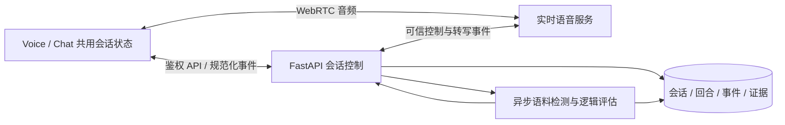

# Stage 4 实时会话：设计与实施计划

日期：2026-09-30。状态：分析完成，尚未实现。

用户已确认首版包含**持续聆听、自动分轮、打断 AI 的实时语音**，同时保留文字输入。这一决定取代原规范“文字首版、语音后续”的范围。下列布局、接口、字段和供应商路线是实施建议，尚未通过生产集成验证。

设计依据：`design/prototypes/libitu_stage4_ai_sandbox.html`、`design/assets/preview.webp`、`design/assets/preview (1).webp`。HTML 中的示例对话、计数、关键词脚本和 `sendPrompt` 是原型演示；参考图中的 ElevenLabs 品牌不代表供应商选型。

## 1. 实现现状与本次边界

| 领域 | 当前可复用 | Stage 4 需要新增 |
|---|---|---|
| 入口 | `/loadout` → `/speaking/[sessionId]`，安全返回路径、登录恢复 | 将 SessionPreparation 替换为会话工作区；查看历史不自动开麦 |
| 会话 | 已保存场景、目标、难度、反馈级别、可选逻辑、语料快照 | 角色设定、开始/恢复/结束、实时连接、回合历史 |
| 选择规则 | 句式 ≤3，chunk+idiom ≤5，总数 ≥1 | 全程使用会话快照，不重新读取可变的 corpus 作为装备 |
| 身份与存储 | Clerk 身份、owner-scoped FastAPI、服务端 Supabase RPC | 回合、连接、事件、检测证据的持久化和账户隔离 |
| 模型 | DeepSeek 文本抽取适配器、结构化验证、SSE 经验 | 实时语音适配器；独立角色与评估 prompt；预算与版本 |
| 音频 | Stage 2 设备权限、取消、释放、媒体生命周期经验 | WebRTC 音频通道、自动分轮、打断、回声处理、重连 |
| `/turns` | 已配置数据库时明确返回 501；inline 只有固定测试回复 | 真实回合受理、事件归一化、持久化，不得保留假回复为回退 |
| 评估 | 尚未实现 Stage 4 检测或反馈 | 有证据的出现记录、结构使用、逻辑进度、可选提示 |

本次 Stage 4 交付终点建议为：真实实时对话、可恢复文字记录、语料使用证据、可靠结束与只读回顾。Stage 5 四维反馈另有任务，结束页只在真实反馈可用时显示相应入口，不跳转到不存在的 Analytics。

## 2. 会话界面

桌面沿用原型的学习工作区结构，主会话视觉采用参考图。推荐主列 `minmax(0,1fr)`，右侧训练栏约 280–320px；不照搬原型固定 860px 高度或图片中的外部网站背景。

```text
libitu  ·  Stage 4 / Sandbox                 场景 · 结束会话
目标：Agree on a revised project deadline
Context → Tension → Proposal → Defend       （可选逻辑模板）
┌───────────────────────────────────┬──────────────────────┐
│ [Voice / Chat]          [专注视图] │ Selected language    │
│                                   │ Expressions  1/5     │
│       语音球 / 会话消息             │ to be fair · turn 2  │
│       Listening…                  │ …                    │
│       当前一句字幕                  │ Structures   0/3     │
│                                   │ …                    │
│ [输入文字…                 发送] ○ │ 本次已出现 N/M       │
│ 麦克风状态 / 暂停 / 连接状态         │ 用户回合 / 提示       │
└───────────────────────────────────┴──────────────────────┘
```

### Voice 视图

- 大球体使用青蓝色渐变，少量黄绿色光斑；白色主面板、克制阴影和圆角。产品主色、选择色继续使用已有紫色，证据绿色，提示琥珀色。
- 球体是状态展示，不是开始按钮。未开始显示 `Start conversation`；开始并取得权限后才进入监听。球体变化来自实际输入/输出音量与连接状态，静音或断线不能继续显示 Listening。
- 展示当前 AI 句子／用户暂定转写，长历史进入 Chat；字幕最终化之前标记为暂定。
- 底部常驻文字输入和独立圆形麦克风按钮。实时模式中麦克风表示静音/取消静音，不是“录制一条语音”。静音输入与停止 AI 播放是两个不同操作。
- 支持点击“停止播放”或直接说话打断；听完不需要再点录音按钮。
- 建议进入打字状态时暂停收音并显示明确状态，避免文字和语音重复提交。提交后不覆盖用户原本的静音设置；通过“继续语音”恢复。

### Chat 视图

- AI 消息暖灰、用户消息淡紫；保留角色标签，但不硬编码 Alex 或某个职场剧情。
- 使用与 Voice 完全相同的消息、输入草稿、连接和音频控制器。切换视图不重新开场，不结束通话，也不重置麦克风。
- 暂定转写逐步替换同一气泡；最终转写进入历史。被打断的 AI 消息显示 `Interrupted`，未播放内容不伪装成已听到。
- 高亮精确证据片段；点击训练卡可定位对应用户回合。避免 `innerHTML`，用经过校验的文本区间组合 React 节点。
- 仅用户位于底部时自动滚动；阅读旧消息时显示“新消息”入口。输入法组字不触发 Enter 发送；Shift+Enter 换行。

### 训练栏与窄屏

- 表达卡合并展示 chunk、idiom，并保留 kind 标记；句式单独分组。显示本次实际选中数量，不把容量上限当作必须完成的目标。
- 指标首版建议仅展示“已出现 N/M”“用户回合”。出现比例不命名为质量迁移率；不显示无依据的流利度分数。
- 每个使用记录有回合、原文、匹配方式；“出现”与“用得恰当”明确区分。评估未返回时显示待评估，不显示失败或零分。
- 逻辑模板为空时隐藏进度条。进度由回合证据支持；未知时不自动前进。普通页面浏览、回合计数不能推进逻辑阶段。
- 专注视图收起训练栏但保留场景、连接和结束控制；退出后恢复。
- 小屏单列，训练栏变为抽屉／折叠区域；输入区适应软键盘与安全区。按钮目标 ≥44px，支持键盘和减少动态效果；在 200% 缩放下保持内容与控件可达。

## 3. 状态与关键行为

不要用一个 `isLoading` 包含所有状态。至少分四层：

| 层 | 建议状态 | 规则 |
|---|---|---|
| 持久会话 | `draft / active / completed / abandoned` | 延用现有业务状态；断线不等于结束 |
| 实时连接 | `idle / requesting_permission / connecting / connected / reconnecting / paused / failed / closed` | 连接与业务会话分开；显示失败原因和恢复入口 |
| 音频活动 | `listening / user_speaking / thinking / ai_speaking / interrupting`，另有 `mic_muted` | 同时保留输入、输出状态；静音不会误标记 AI 停止 |
| 保存与评估 | `pending / saved / failed`，`pending / ready / unavailable` | 已显示的回复不因后台检测失败被删除 |

具体规则：

1. **开始**：语音路径为读取会话 → 用户点击开始 → 麦克风权限 → 服务端创建 runtime → 可信事件监听就绪 → 语音连通 → 角色开场。用户选择文字或拒绝麦克风时，仍可启动文字可用的会话；随后显式启用语音并带入同一历史。开始请求带幂等键，重复点击、刷新或重连不能重复开场。
2. **自动分轮**：使用所选实时服务的分轮能力，并针对英语学习者的停顿调参。听到一个停顿不直接视为一句说完。初期用真实说话测试调节，不把固定静音秒数当学习能力判断。
3. **打断**：用户开始说话时停止当前播放、取消对应生成、清除待播音频；记录当前 response 被打断及可信播放边界；迟到音频/文本不得重新播出。下一次响应基于可确认已经播放的上下文；播放报告不能证明用户实际听到了内容。
4. **文字插入**：文字走同一会话控制器，携带唯一提交 ID。正在说话时明确停止／打断当前输出后插入；不得并行创建第二个聊天会话。
5. **断线恢复**：保留正式回合；丢失的未确认音频不得自动重放。重连后以服务端历史为准；无法继续原 provider session 时创建新 runtime 并带入已确认上下文，仍属于同一 Libitu 会话。必要时提示用户重说最后一句。
6. **刷新**：恢复消息和使用记录，显示“继续会话”，不自动开麦或播放开场。
7. **多标签**：一个会话同时只有一个活动语音连接。第二个标签先只读；用户显式接管后增加 runtime generation、关闭旧连接，旧事件不得覆盖新连接。
8. **离开与后台**：卸载/退出/换账户立即释放媒体并终止旧 runtime；切换 Voice/Chat 不卸载媒体。建议页面进入后台时暂停收音，回前台明确继续；这一行为需在移动端验证。
9. **结束**：立即停止收音与播放；后台按可重试的结束操作收齐已经提交的最终事件，在有界等待后标记缺失内容，再写入 `completed`。最终转写缺失不能凭猜测补齐。提供保存中／可重试状态。

## 4. 实时架构与选型

推荐采用托管实时语音服务，让浏览器承载 WebRTC 音频，让 FastAPI／专用实时进程掌握会话、可信事件与持久化。学习评估旁路处理，不阻塞 AI 开口。



候选路线如下。推荐先验证 A；这是基于当前系统需要可信实时事件与会话控制作出的工程判断，并非已经选定服务或完成实测。

| 路线 | 适配方式 | 优点与需要验证的限制 |
|---|---|---|
| A：OpenAI Realtime + WebRTC + 服务端 sideband | 浏览器传输语音，服务端接收同一会话事件并控制上下文 | 官方有 WebRTC、VAD 打断与 sideband 能力；需新增服务配置，并验证当前模型可用性、文字混入、转写顺序、播放截断、成本和地区延迟 |
| B：ElevenLabs Speech Engine + 服务端对话模型 | 语音服务发可信转写给后端，后端流式返回对话文本 | 可保留独立文本模型；官方提供 upstream 事件和旧响应丢弃机制。需外部可达的后端 WebSocket、取消链路、实际播放边界验证，运营组件更多 |
| C：自建 STT → 文本模型 → TTS 实时流水线 | 自行管理每一段音频、VAD、队列、取消和播放 | 控制最细，但不是首版建议；Stage 2 的批量音频分析不能直接承担该路径 |

官方依据：[OpenAI WebRTC](https://developers.openai.com/api/docs/guides/voice-webrtc?voice-api=realtime)、[服务端 sideband](https://developers.openai.com/api/docs/guides/voice-server-controls)、[打断与截断](https://developers.openai.com/api/docs/guides/realtime-conversations)、[ElevenLabs Speech Engine upstream](https://elevenlabs.io/docs/api-reference/speech-engine/speech-engine-upstream)。

先做有界技术验证，冻结一个 provider、SDK/API 版本及事件映射，再开始依赖其语义的完整实现。验证内容是：连续说话／思考停顿、开口打断、打断后上下文、最终转写、文字混入、断网重连、真实设备回声、服务器权威事件来源和资源关闭。并记录响应首音、打断停止和转写完成的 p50/p95、分钟成本；这轮分析不虚构延迟或费用。

模型配置独立于 Stage 1。现有 `deepseek-v4-flash` 是仓库当前配置，不应在 Stage 4 工作中顺便迁移；若 B 路线沿用 DeepSeek，实施时验证其账户可用模型。流式文本与结构化评估分开，不能把音频回复绑在完整大 JSON 验证之后。[DeepSeek 流式／JSON 接口](https://api-docs.deepseek.com/api/create-chat-completion/)

## 5. 字段与接口草案

### 数据模型

沿用现有 `speaking_sessions`、`speaking_session_items`、`speaking_turns` 和 `speaking_feedback`，审查已有列与约束后迁移。下面是逻辑模型，不意味着每个对象必须新建一张表。

| 对象 | 核心新增字段 | 目的 |
|---|---|---|
| Session | `version, started_at, ended_at, role_snapshot, active_runtime_id, last_event_seq, finalization_status` | 角色固定、恢复、乐观并发、结束状态 |
| Runtime | `id, session_id, provider, provider_session_id, generation, state, lease_expires_at, config_version, closed_reason` | 临时语音连接与持久会话分离；单连接接管和旧事件隔离 |
| Turn / message | `id, session_id, runtime_id, ordinal, role, input_source, client_turn_id?, provider_item_id?, response_id?, reply_to_id?, transcript_revision, transcript_status, text, delivery_status, interrupted_at_ms?, created_at` | 语音/文字统一；消息不是固定一问一答的数组位置 |
| Transcript revision | `turn_id, revision, source, original_text, corrected_text?, finalized_at` | 暂定/最终/用户纠正分离，不悄悄改写历史证据 |
| Evidence | `id, session_item_id, turn_id, transcript_revision, start, end, quote, match_type, appropriateness, reason?, evaluator_version` | 锚定 session snapshot 和具体用户文本，支持重算与回溯 |
| Logic progress | `stage_id, status, evidence_turn_ids, reason?, evaluator_version` | 有依据推进，允许未知；无模板时为 null |
| Event | `id, seq, session_id, runtime_id, generation, type, entity_id, revision, payload, created_at` | 去重、有序回放、刷新恢复；不持久化每帧音量和原始音频 |

约定：`turn_count` 是已经最终化且非空的用户回合数，不含 AI 开场、暂定字幕和重放事件。所有证据区间统一为明确约定的字符串索引（建议 UTF-16 `[start,end)` 与前端一致，Python 端显式转换验证），并校验 `quote` 对应原文。

AI 输出需要区分生成文本与已播放范围。只有 provider／可验证时间对齐支持时才持久化精确已播放文本；未知边界保留 `partial/unknown`，不按字数比例猜测。用户语音转写是识别结果，不等于经过独立验证的准确原话。用户纠正保留原版本，重算证据，并明确其来源。

### API

基路径 `/api/speaking/sessions/{session_id}`。所有私有操作沿用 Clerk，`user_id` 从服务端身份取得。

| 接口建议 | 职责 |
|---|---|
| `GET /`（已有） | 会话快照及运行摘要；GET 不创建通话或付费调用 |
| `POST /realtime` | 带 `client_connection_id`、`expected_version` 和受限协商参数启动/恢复；返回 runtime、短时连接材料或 SDP answer |
| `POST /realtime/{runtime_id}/control` | 幂等暂停、恢复、停止输出、显式接管；音频打断由实时协议处理，不依赖慢速 HTTP 才停止本地播放 |
| `GET /turns?after=...` | 分页恢复权威历史，包括被打断和待确认状态 |
| `POST /turns`（替换占位） | 文字输入带 `client_turn_id, text, expected_version` 进入同一个活跃会话；语音最终回合由可信 provider 事件产生 |
| `GET /events?after_seq=...` | 认证 SSE 传输规范化持久事件；fetch stream 携带认证头，断线按 seq 补取；语音仍走 WebRTC |
| `POST /hints` | 主动请求一条非代答提示，不创建伪用户回合 |
| `POST /end` | 带唯一操作 ID 幂等结束；返回保存/最终化状态，可重试 |
| `PATCH /turns/{id}/transcript` | 建议纳入：纠正识别文字，保留原版本，重算相关证据 |
| `DELETE /` | 关闭活跃连接并删除本账户会话及派生记录；原始音频若未来可选保存需同步清理 |

Provider sideband/upstream 是服务端适配器，不是允许浏览器写入 `role=assistant`、任意分数或 logic 状态的公共接口。短时凭证不得写入 localStorage、日志或共享链接；会话绑定与授权必须由服务端校验。

仅有 sideband 还不等于浏览器操作天然可信。供应商验证必须检查客户端是否能注入 assistant 消息或改写系统配置；正式 AI 历史只接受绑定当前 runtime、由允许的 response 生成的事件。若所选协议无法限制或区分这类客户端操作，需服务端代理相应控制消息，不能把客户端插入后又被供应商回显的消息当作模型产出。

### 一致性

- 文字提交按 `(session_id, client_turn_id)` 去重；相同 ID 不同内容返回冲突。Provider 事件按 provider/runtime/event 或 item/revision 去重。
- 接收时间与语义顺序分开；最终转写可能乱序到达，不能按 HTTP/WS 到达顺序重新拼成对话。
- 数据库只做短事务；不在行锁中等待语音或模型。长连接由支持 WebSocket 生命周期的进程持有，用带 generation 的 lease 阻止旧进程回写。
- 断线后的供应商调用不能承诺绝对“只计费一次”；做到应用事件幂等、运行时对账与受限重试，不盲目启动重复生成。
- 结束／删除先封住新输入和旧 generation 写入；允许属于结束操作的已提交最终事件在有界时间内完成，再封存 revision。
- 纠正转写不新增用户回合、不重新播放历史回复；相关证据随版本重算，后续模型上下文明确附带纠正说明。
- 真实对话链路失败明确展示；不能回退为 inline 固定句、假字幕或假完成。

## 6. 角色、检测、提示

**角色生成**读取服务端 loadout snapshot：场景＋具体目标＋难度＋语料＋逻辑。首个 runtime 固定角色姓名/身份、关系、冲突和开场，重连不随机换人。AI 保持角色，制造自然表达机会，不在对话里朗读评分 JSON，也不每轮逼用户塞进所有表达。

**难度**建议 guided 给更多具体问题和等待空间；standard 自然跟进；challenging 增加合理追问和约束。不能仅通过语速快慢或故意难听清来提高难度。

**检测**只基于用户最终文字及其明确版本。chunk/idiom 首先做保守的完整词序列匹配，保留归一化到原文的偏移映射；出现某个单词不表示整条表达已使用。结构需要槽位与句法/语义判断，不用 `Given` 一词判定完整结构。独立评估器输出候选证据，服务端校验归属、范围和原文后接受。

**统计**以不同 session item 去重，同一项用了五次仍只占一个已出现项；重复使用次数可在详情展示。模型判断“恰当”应有理由且标明判断性质。ASR 不确定、结构证据不足或评估超时，保持 unknown/pending；不输出虚构 confidence 或准确率。

**提示与反馈**位于学习侧栏，默认不打断 AI 音频。一次只指向一个已选项及表达意图，不替用户写完整答案；按主动求助或有依据的困难信号出现。light/balanced/detailed 调整提示和解释量，具体频率在交互验收时校准，不用固定短句长度推断用户能力。

## 7. 前后端任务与依赖

| ID | 负责 | 任务 | 完成条件 |
|---|---|---|---|
| S4-00 | 共同 | 冻结实时状态、规范化事件、回合/证据字段、结束语义；供应商技术验证 | 文本与语音同一session；可信最终事件、打断边界、文字混入可证明 |
| S4-F1 | 前端 | 薄路由＋`features/speaking`工作区；Voice/Chat、logic、训练栏、移动布局 | 同一session状态；视图切换保留输入；无假完成标记 |
| S4-B1 | 后端 | 会话runtime、回合、事件、证据迁移与repository | owner隔离、唯一键、generation、结束/删除竞态通过事务测试 |
| S4-F2 | 前端 | 实时媒体controller、权限、播放、静音、打断、设备/网络状态 | 单一媒体所有者；连接退出无残留音轨；状态忠实 |
| S4-B2 | 后端 | 选定实时provider、会话协商、可信控制连接、角色prompt | 开场幂等、持续语音、自动分轮、打断、预算和超时限制可用 |
| S4-F3 | 前端 | 增量字幕、稳定消息ID、文字混入、历史恢复、SSE归并 | 乱序/重复不会复制消息；刷新不自动开麦；账户切换隔离 |
| S4-B3 | 后端 | 事件归一化/持久化、文字受理、重连和接管 | 旧runtime不能写新会话；无法恢复音频明确提示；历史一致 |
| S4-B4 | 后端 | 表达/结构证据、logic评估、提示旁路任务 | 每条结果关联真实用户回合，检测失败不拖住语音 |
| S4-F4 | 前端 | 使用高亮、证据跳转、提示、转写纠正、结束/只读回顾 | 统计去重、评估未知可见、结束保存可重试 |
| S4-Q1 | 联调 | 自动化、真实设备与真实provider验证 | 完整Loadout→实时对话→打断→使用证据→结束→刷新回顾闭环 |

并行顺序：S4-00 → F1/F2 与 B1/B2 同时开展 → F3/B3 联调 → F4/B4 并行 → Q1。内部可先验证文字回合，但首版验收必须包含用户已确定的实时语音，不能以文字版代替完成。

建议代码归属：`apps/web/features/speaking/{components,hooks,api,realtime}`；`packages/types/src/speaking.ts` 扩充共享类型；`apps/api/app/{routers,schemas,services,integrations}` 增补 speaking 分层；独立 realtime worker/controller，避免把长连接塞进现有音频批处理 worker。

## 8. 验收与运行要求

- 浏览器：1440/768/390、键盘/输入法、真实 200% 缩放、软键盘、reduced motion；Voice/Chat/专注切换不丢会话或媒体。
- 音频：权限拒绝、权限悬挂后取消、设备拔出、静音、耳机与扬声器回声、长停顿、噪声、AI讲话中开口、连续打断、后台恢复。
- 网络与状态：重复事件、乱序最终转写、partial→final纠正、断线半句、重连、刷新、多标签接管、登出换号、结束/删除与迟到事件竞争。
- 证据：大小写和标点、子串误判、重复短语、多项同时命中、结构槽位、否定/引用场景、ASR纠正撤销旧证据、AI自己说出不算用户使用、所有区间真实可定位。
- 真实集成：正式provider音频与文本事件、角色稳定性、服务端历史一致、打断后上下文、资源关闭、会话成本和延迟分布。Fixture测试不能替代此项。
- 运行：实时服务器支持长连接、重连与进程重启；并发/时长/费用有服务端上限，空闲连接主动释放。根lint/build/test和Loadout/Shadow回归通过。
- 数据建议：Libitu首版保存会话文字与派生证据，不默认保存原始语音；实时传输处理、可选录音保存和训练用途分开说明。供应商保留设置要在选型验证时核实，不能把“不写本地数据库”表述为“任何地方都不留音频”。麦克风从用户操作开启，使用HTTPS或localhost。[浏览器麦克风要求](https://developer.mozilla.org/en-US/docs/Web/API/MediaDevices/getUserMedia)

## 9. 本轮产出与待固定事项

本轮只记录分析、任务和交互草案；未安装语音SDK、调用付费模型、创建实时服务配置或修改数据库／产品代码。

已确定：首版实时语音范围、继续复用Loadout选择规则。建议待实施验证后固定：供应商与具体模型/声音、断句敏感度、连接与费用上限、精确保留策略、结束后Stage5联动的交付范围。无需因此停止界面和规范化事件的独立设计。
