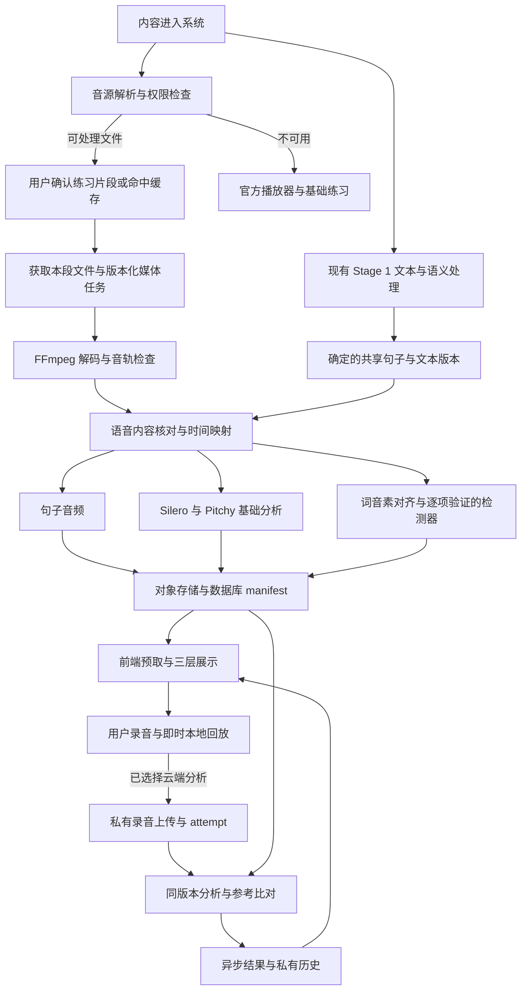

# Stage 2：文件式原音预处理目标架构

2026-09-22 实现进展：允许来源的文件原音已接入服务器管线；F4 已加入用户录音异步分析、独立内容核对、逐词对齐、Rhythm/Melody 描述性对比与保存。通用 YouTube 原音获取、生产部署和经人工验证的发音评分仍未完成。详见 [用户分析实现](STAGE_TWO_PRACTICE_ANALYSIS.md)。

日期：2026-09-09。状态：**目标架构已接受，以下新增流程、接口和存储尚未实现。** 本次只更新方案；现有实现仍是 Chrome 标签页采集与浏览器本地分析。本文中的性能数值、容量和保留期是待验证的工程默认值，不是已达成的指标。

## 1. 产品结论

把原音准备变成内容基础设施，**默认按用户选中的练习片段获取和预处理，不默认下载或分析整条视频**。内容进入系统时先检查音源能力与缓存；用户确认片段时，后台获取该范围及必要上下文，生成句子音频、时间映射和分析结果。用户进入 Shadow 时优先读取已有资产，点击播放即可听原音，点击录音即可练习。

“文件式”指分析可解码的媒体字节，不限制文件必须是整条视频。服务器取得一段 45 秒的音频文件，也属于文件式预处理。可另为运营选定的授权热门内容提前准备，作为改善首次体验的优化，而非所有导入内容的默认动作。

正常练习流程不包含 Enable practice audio、Chrome 工具栏授权、逐句采集，也不要求先按 1× 把内容播放一遍。首次录音仍需要浏览器麦克风权限；后续是否再次询问由浏览器、站点权限和设备环境决定，产品不能承诺永久免授权。

必须把两个条件分开：文件预处理解决计算与交互方式；源文件接入解决系统究竟能处理哪些内容。不能因为采用文件架构，就承诺任意 YouTube 链接都有可下载、可保存的原音。

## 2. 用户路径与降级行为

| 场景 | 用户看到的体验 | 系统动作 |
|---|---|---|
| 已准备内容 | 直接选句、听原音、录音；三层显示已有参考数据 | 读取轻量 manifest，预取当前句与后两句 |
| 首次导入、文件可用 | Stage 1 正常阅读；显示内容具备原音对比能力 | 文本处理与音源能力/缓存检查并行，暂不为整条视频下载音频 |
| 用户确认练习片段 | 显示“正在准备本段音频”，可直接进入练习页 | 幂等提交该片段范围；获取、切句、基础分析在后台执行 |
| 进入 Shadow 时只准备了部分句子 | 已就绪句子可用；当前句显示具体准备状态 | 提升当前句优先级，补齐本片段；不自动扩展到未选片段 |
| 原音已就绪、详细分析未完成 | 可听、可录；已完成的层先展示 | Rhythm、Melody、词级对齐和 Sound 检测独立发布结果 |
| 普通 YouTube 链接没有可处理文件 | 仍可用官方播放器听、读文本和录音回放；明确“该内容暂不支持原音对比” | 不反复重试不存在的音源，也不偷偷切回标签页录制 |
| 用户录完后切换句子 | 立即可回放；分析继续，结果归入原句练习记录 | attempt 固定绑定句子与参考版本，迟到结果不覆盖新句 |
| 网络或后台短暂失败 | 已有数据和录音保留，显示可恢复状态 | 有界重试；等待时仍可继续练习 |

进入页面和切句默认保持暂停。预取只下载数据，不启动视频、原音或麦克风。云端分析失败不应清空已完成的录音；本地临时模式离开页面后的保留能力必须明确说明。

内容列表、片段选择处提前给出“支持原音对比 / 准备中 / 基础练习”的能力标记。不要到用户录完才首次告知原音不存在。内容解析阶段就能判定永久不可用的，立即给出状态。

### 操作区

保留已经实现的“视频和操作区在三层分析上方”布局，按 [DESIGN.md](DESIGN.md) 的视觉约束细化按钮；按钮样式重做尚未实施。

- 常驻主要动作：播放/暂停、录音/停止、回放我的录音、上一句/下一句。
- 倍速、循环、句子/片段范围作为次级控制，播放状态与录音状态清楚可见。
- 删除目标主流程中的 Enable practice audio，将准备情况显示为轻量状态；重试只在可恢复失败时出现。
- 录音时暂停其他音源，原音、视频和用户回放只能有一个发声。切换 Sound/Rhythm/Melody 不销毁播放器、录音或任务。
- 句子原音播放优先使用已授权的句子文件。YouTube 视频保留“看原片”入口与官方播放器，播放时暂停句子音频。第一版不承诺 iframe 与外部音频逐帧同步；自有视频文件可后续统一媒体时钟。

## 3. 总体数据流

参考处理按内容版本与片段范围复用，相同句子的资产可在匹配的窗口/处理版本下复用；用户处理按每次练习执行。两者用独立队列和容量配额，避免媒体导入阻塞短录音反馈。文本规则推断可与基础声学分析并行，不需要把 DeepSeek 放在所有声学任务前面。

## 4. 音源接入是首要依赖

| 音源 | 建议定位 | 前置条件 |
|---|---|---|
| 内容方直接交付的音视频文件及字幕 | 第一版完整体验的默认来源 | 权限覆盖处理、切片、播放、保存、衍生特征及目标地区 |
| 已有授权媒体库或合作方文件 API | 自动入库适配器 | 可稳定获得指定原语言音轨，接口与许可允许相应处理 |
| 创作者或用户主动提供文件 | 内容导入入口，不能变成每次练习的操作 | 权属与访问范围明确；私人文件不得自动公开或跨用户共享 |
| 普通 YouTube 链接 | 保留当前产品入口，先解析完整能力 | 官方 iframe 用于播放；没有文件来源时提供基础练习 |
| YouTube 下载适配器 | 条件性技术选项，未选为默认生产来源 | 同时解决内容权利、平台许可和接口稳定性，才纳入实现 |

YouTube IFrame API 提供播放控制与事件，没有可供该流程直接读取的原始音频接口。[官方 IFrame 文档](https://developers.google.com/youtube/iframe_api_reference)

`yt-dlp` 在技术上可获取媒体文件，不需要等待用户实时播放；但它是独立下载工具，不能视为 YouTube 官方媒体 API，也不能替代必要授权。下载、缓存和分离音视频等使用还受平台政策约束；创作者同意与平台许可需要分别确认。[yt-dlp 项目](https://github.com/yt-dlp/yt-dlp)、[YouTube 开发者政策](https://developers.google.com/youtube/terms/developer-policies)

不把人工逐句上传转嫁给学习者。内容方文件入库应由运营、合作接口或系统任务完成。当前尚未确定实际可用的授权内容源，因此“完整支持任意 YouTube 链接”仍是开放的产品与接入问题，不能作为本方案已解决的能力。

## 5. 参考文件处理步骤

### 5.1 按片段触发与获取

内容 resolve 时只解析来源能力、版本和现有缓存。用户确认片段或点击该片段的 Shadow 入口时，查询覆盖该范围的资产；命中直接复用，未命中则持久化本段任务后入队。Stage 1 文本处理不等待媒体任务；片段边界与文本已确定后，音频任务也不必等待其他语义分析完成。单纯滚动、悬停或临时拖动范围不触发下载。

例如选择 02:10–02:55 的 45 秒片段，可先请求约 02:09–02:56，给边界校验和对齐保留各 1 秒上下文；这是初始工程默认，遇到跨边界词句需按确定的句子范围调整。随后服务器按句切分，不再为每句重新访问上游。用户以后选择另一个片段，再提交那个范围。

需要分别记录获取模式与实际网络传输量：

| 上游能力 | 获取策略 | 是否保证仅传输目标时间范围 |
|---|---|---|
| 提供按时间裁剪的合法文件 API | 请求片段与上下文文件 | 以接口行为为准，最适合该流程 |
| 可授权访问的 HLS/DASH 分段媒体 | 获取清单及覆盖该时间的媒体分段，再精确裁剪 | 会多取相邻分段，通常不是恰好 45 秒的字节 |
| 带可用索引且支持 HTTP Range 的文件 | 定位所需字节范围，解码再裁剪 | 依赖容器索引、编码和服务端 Range 实现；需实测 |
| 只有完整文件下载 | 只能下载全文件后裁剪，或暂不支持按需原音 | 不能保证；默认不悄悄退化为大文件全量下载 |
| Libitu 已有的授权源文件 | 从现有对象/工作缓存读取本段 | 无需重新从外部平台下载，内部读取量仍需测量 |

FFmpeg 的起止时间参数定义处理窗口，不自动保证底层只传输该时间范围；只有音源和容器支持相应定位时才能节约上游流量。适配器必须报告 `clip_api / segmented / byte_range / full_file_only / unavailable` 等能力，并设置实际传输、时长、任务时间预算。[FFmpeg HTTP 协议与范围读取](https://ffmpeg.org/ffmpeg-protocols.html#http)

对于已确认允许使用的来源，`yt-dlp --download-sections` 也提供按时间范围下载的能力，并依赖 FFmpeg；可作为 F1 适配器实验候选。指定时间范围本身仍不能替代实际流量与源可用性测试。[yt-dlp 下载选项](https://github.com/yt-dlp/yt-dlp#download-options)

只有经过显式配置、限定成本的授权来源可以允许完整文件回退；未配置时返回该来源暂不支持片段原音，保留基础练习。分段获取同样要满足来源许可，不能把“只取 45 秒”视为自动获得 YouTube 下载或存储权限。

### 5.2 创建可恢复任务

任务幂等键包括访问权限范围、来源版本、音轨、所选时间窗口、文本版本及处理版本。共享只发生在允许共享的内容范围内。用户私人导入即使字节相同，也不能通过全局去重查询泄露他人的文件是否存在。

确认片段后可以开始获取和解码，但句子资产必须绑定最终稳定的共享句子版本。不能拿仍在变化的 SSE 文本切片直接生成永久 sentence ID。现有旧蓝图读取时的句子格式迁移也必须触发版本核对。保存片段到源视频的时间偏移；片段内 0 秒不能被误认为源视频 0 秒。

### 5.3 校验并标准化音频

用 FFprobe/FFmpeg 检查文件、时长、声道、音轨语言、采样率和解码有效性。选择与学习文本一致的原语言音轨，防止把自动配音、不同剪辑版或包含额外片头的文件当成同一来源。

保留可追溯源文件或其受控上游身份；分析使用统一 16 kHz 单声道 PCM。回放使用经过浏览器兼容验证的压缩音频，保留精确的解码时长、编码延迟/裁剪映射。用于测量的输入不应用改变时序的倍速处理，不静默进行降噪或响度归一化。

FFmpeg 可以直接解码、转换和裁剪文件，处理速度受下载、硬件和模型影响，不要求按内容时长实时播放；不能承诺任何视频都瞬间完成。[FFmpeg 文档](https://ffmpeg.org/ffmpeg.html)

本段按当前句、后两句、片段剩余句子的顺序发布结果；只有用户选择其他片段或运营任务明确要求时，才扩展准备范围。长片段可以分批处理；下载是否支持范围请求、随机定位，取决于上游协议和编码，不能假定总能只取几秒。

### 5.4 核对文本与声音

字幕、清理后的阅读文本和实际说出的内容可能不同。保留三份映射：显示文本、逐字语音文本、音频时间；删去的语气词、重复、数字展开和缩写不能无痕消失。

已校对且与文件绑定的逐字稿可直接用于对齐。普通自动字幕应做独立内容核对；缺失或明显不一致时再运行 ASR。可自托管 faster-whisper 作为候选，Whisper 不是强制依赖，也不必为每条已有可信逐字稿的内容重复转写。[faster-whisper 项目](https://github.com/SYSTRAN/faster-whisper)

词/音素边界可用 MFA 等强制对齐器生成。强制对齐是在给定文本下寻找时间位置，不证明文本正确，也不证明学习者确实说了目标句。[MFA 对齐工作流](https://montreal-forced-aligner.readthedocs.io/en/latest/user_guide/workflows/alignment.html)

第一版可先发布经内容与裁剪质量检查的句子级参考，保留 `timing_precision=caption_estimate` 或 `sentence_verified` 等明确状态。词级图形与 Sound 检测必须等对应对齐质量通过；不能把字幕估计位置升级为“精确音素边界”。

### 5.5 切句与基础特征

每句保存目标边界、可播放的上下文边界、源文件偏移，以及用于分析的实际窗口。初始上下文 padding 可取前后各 150 ms，并受相邻句、片段与文件边界约束。停顿计算只使用定义好的分析窗口，不能把 padding 当作用户需要模仿的停顿。

基础版本继续使用现有算法：Silero V5 做语音活动检测；Pitchy 4.1.0 做基频与清晰度估计；复用节奏、停顿和相对音高的纯计算逻辑。每层独立质量门限，背景音乐、多说话人、静音、截断及低有声覆盖率应降低可用范围，而不是输出貌似精确的分数。[Silero 项目](https://github.com/snakers4/silero-vad)、[Pitchy 项目](https://github.com/ianprime0509/pitchy)

运行方案默认是 Python 负责任务编排、FFmpeg 和后续对齐；常驻 Node 声学 worker 使用原生 ONNX Runtime 与共享 TypeScript 计算逻辑。现有 Web Worker、AudioContext 和 WASM 包不能原样放到服务端；需要输入适配、模型状态管理与一致性验证。[ONNX Runtime Node 文档](https://onnxruntime.ai/docs/get-started/with-javascript/node.html)

服务端发布新的 `analysis_version`，固定解码、重采样、模型校验和、Pitchy 版本及门限。参考与学习者采用同一分析版本；不能默认把浏览器旧结果与新服务端结果混合评分。使用同一 PCM 的跨运行时验证检查差异，另测不同浏览器录音编码造成的差异。

CREPE/torchcrepe 可以作为后续基频评测候选；是否替换由真实语音、噪声和延迟数据决定。第一版不因算法名称直接增加 GPU 依赖，也不声称某模型在所有场景最好。[torchcrepe 项目](https://github.com/maxrmorrison/torchcrepe)

### 5.6 三层产物分开发布

| 层 | 第一版可发布内容 | 仍需后续工作 |
|---|---|---|
| Sound | 现有词典 IPA、条件性音系规则提示 | 词/音素对齐、真实现象检测、逐项校准 |
| Rhythm | 语音跨度、内部停顿、句级时序比较 | 词重音、音节时长与词级节奏对齐 |
| Melody | 有声区间、相对音高曲线、音域 | 可靠词级曲线匹配、句核重音与语调评价 |

LLM 只接受文字、音素及语言学上下文来推断候选规则，不负责声学分析。规则候选、参考实际读法、用户实际读法是三个不同字段。文件预处理完成不等于 Sound 的 M4b 检测器已经完成。

不要仅靠两个归一化曲线的相似度给发音总分；同一时间比例不代表同一个词。学习者比较前需检查是否说了对应内容，独立对齐其实际语音，并对删除、增加、重复词保留不匹配信息。当前描述性节奏/音高结果可以先交付；等级与评分另经校准。

## 6. 就绪状态、缓存和版本

参考 manifest 包含内容/源文件/音轨/文本/句子/分析版本、句子列表、资产 ID、可用能力、质量原因与任务状态。它引用音频对象和特征文件，不内嵌 base64 音频，不包含长期有效的私有下载地址。

任务状态建议为 `queued / running / partial / ready / failed / unavailable`，并携带失败原因和 `retryable`。每句分别记录 `audio`、`rhythm`、`melody`、`alignment`、`sound_observations` 的状态；未实现的能力使用 `not_supported`，不能永久显示为“准备中”。

前端先取当前片段的 manifest 与当前句小型特征，再预取后两句音频；初始预取预算取 5 MiB，弱网/节省流量时只取当前句。整片长曲线按需加载，不为进入一个句子拉取整部视频的所有特征。

音频以不可变资产版本缓存；短效 URL 过期时刷新地址并保留选择与播放位置，不重新做分析。前台可用缓存不意味着永久离线权限；私人音频不进入公共 CDN URL 或公共蓝图缓存。客户端退出账号时清理用户缓存。

参考版本更新后，新练习使用新版本，旧 attempt 仍指向其当时版本。历史曲线明确版本和任务条件；若要重算，创建新评估记录，不静默覆盖原结论。授权到期后停止签发访问地址，并按协议清理或停止展示相关参考产物。

## 7. 用户录音、异步反馈与历史

录音仍由浏览器 MediaRecorder 完成，保持现有最长 60 秒限制。停止并完成编码后立刻建立本地回放地址，不等待上传或模型。若参考尚未准备好，允许录音与保存，比较状态为等待参考；参考最终不可用则结束等待，只显示有依据的用户侧结果。

已登录且选择云端分析时：创建 attempt → 获取该对象专用上传凭据 → 浏览器直接上传私有对象存储 → 服务端核验文件并 finalize → 入学习者分析队列 → SSE/轮询更新结果。为 create/finalize/retry 使用幂等键。服务器依据固定句子和参考版本获取目标文本，不信任客户端提供的 owner 或评分基准。

attempt 从开始就绑定用户、句子、参考版本与练习条件。切句后继续上传/分析；返回该句或历史页可查看结果。已上传任务不依赖页面存活。未上传的 Blob 先用有界内存待传队列保留，建议最多 5 条且总计不超过 32 MiB；满时提示重试/清理，不悄悄丢弃。

第一版不承诺未上传录音能跨刷新恢复。离开页面前说明未保存状态；跨刷新重传需要后续明确的 IndexedDB 临时留存与清理设计，不能把音频塞进 localStorage。

未登录或未选择云端分析者继续基本播放、录音与本地回放；已有本地测量可作为可选能力，但不承担默认首次体验的模型下载。是否开启云端分析和保存录音在首次使用/设置处决定，不在每句录音时重复询问，也不在点击录音后突然弹登录框。

保存三类独立数据：参考资产、用户录音、版本化练习/评估。进步对比同时记录播放倍速、文本是否可见、任务类型、音质与测量版本，避免把慢速看稿练习与正常速度脱稿练习直接排序。学习等级与推荐后续读取这些事实；当前音高与停顿无法单独评出 CEFR。

## 8. 存储、身份与生命周期

默认沿用 Supabase Postgres 保存关系和任务，新增私有对象存储保存文件；参考媒体与用户媒体分桶或使用独立策略。Supabase 私有桶支持受控下载和有时效的签名 URL；公开桶的 URL 不能用于保护私人练习录音。[Supabase Storage 访问模型](https://supabase.com/docs/guides/storage/buckets/fundamentals)

初始权限链为 Clerk → FastAPI 验证身份/内容权限 → 签发特定对象上传或下载权限。现有 Clerk 到 Supabase 客户端直连信任并未完成验证，不能假设浏览器携带 Clerk token 就能安全直传任意对象。服务端密钥不进入前端；上传后再检查实际类型、字节数、时长和所有权。

短录音优先简单直传加重试；较大源文件或弱网使用 TUS 断点续传。Supabase 支持带签名上传 token 的可恢复上传，具体接口应在实现时锁定 SDK 版本并测试。[Supabase 可恢复上传文档](https://supabase.com/docs/guides/storage/uploads/resumable-uploads)

建议的逻辑实体如下，**不是已存在的表或迁移**：

| 实体 | 主要内容 |
|---|---|
| media_sources | 来源、音轨、校验和、访问范围、许可与撤回状态 |
| reference_versions | 源/文本/处理版本及发布状态 |
| sentence_assets | 共享句子、源时间映射、音频对象、各层产物与质量 |
| media_jobs | 持久任务、阶段、尝试次数、租约与故障信息 |
| practice_attempts | 私有用户录音引用、句子/参考版本、练习条件与保留选择 |
| practice_assessments | 每次处理的测量、证据、模型版本、不确定性 |

参考资产在允许共享的内容范围内只存一份，attempt 仅引用；私人用户音频永不作为公共参考。大型曲线放版本化特征文件，小型摘要及查询字段入数据库。Redis 只存任务 ID、优先级和短期协调状态，不保存录音或唯一一份任务事实。

建议工程默认值：下载签名 10 分钟并按需刷新；失败/未完成上传与未选择长期保存的分析输入最长 24 小时内清理；选择长期回放的录音初始保留 90 天并向用户明确展示。最终保留政策需结合实际市场、成本与合同确认。这些值不改变当前代码，也不表示用户已同意长期保存。

当前云分析、长期回放、模型训练/人工复核分别记录目的与选择；训练/复核默认关闭。删除录音与删除学习历史提供独立入口；账号删除处理关联对象、记录、处理方副本及备份到期策略。衍生数据仅在仍有适当依据时保留。撤回权限不能收回已被下载的副本，短效签名也不能代替对象和缓存的删除流程。

容量估算可以先用：64 kbps 回放音频约 0.48 MB/分钟；16 kHz、16-bit 单声道 PCM 约 1.92 MB/分钟，不含容器开销。长期优先保存压缩回放文件与必要特征，工作 PCM 在任务完成后清理；是否保留可复算的原始录音取决于用户保留选择。

## 9. 任务执行与可靠性

继续使用已有 FastAPI、Supabase 与 Redis 边界，但新增媒体任务恢复能力。现有 blueprint 队列不是现成的音频处理系统。以 Postgres 持久任务为事实源，通过 outbox 或定期恢复扫描修复“已入库但未入队”；Redis 丢失、worker 崩溃后能重建待执行工作。

媒体 worker 使用常驻容器和常驻模型，限制文件时长、内存、解码时间和并发。不把 FFmpeg/MFA 等长任务放在 Next.js 请求、Vercel/Edge 请求或不持久的 API background task 中。

建议初始采用两类队列：学习者短录音高优先级；参考处理内部按当前句/本段其余句/明确提交的运营预处理排序，并保留最低吞吐，避免后台任务饿死。CPU 并发通过基准确定，不沿用文本 worker 的并发数作为结论。

任务租约、心跳、幂等落盘与指数退避共同处理重复执行。瞬时网络故障默认最多追加重试两次；权限不足、源不可用、内容不一致不会靠循环重试解决。对象写入与校验完成后才发布 manifest，失败产物可清理，不展示半写入结果。

用户离开页面只取消订阅，不取消其他用户复用的内容任务。对私人输入，任务访问和取消都验证所有权。外部 URL 适配器上线时限定协议/来源，检查重定向、私网地址与凭据泄露风险；文件解析在受限进程执行。

API 草案如下，仅用于说明边界，路径未定稿、尚未实现：

| 动作 | 行为 |
|---|---|
| POST 内容 reference preparation | 片段确认时幂等提交范围；服务端验证片段归属与边界，限制任意范围滥用，必要时提升当前句优先级 |
| GET reference manifest | 读取权限范围内的资产与分层状态；不因 GET 创建任务 |
| GET media job events / status | 复用 SSE + 轮询模式，返回真实阶段、已完成句数和可重试原因 |
| POST media access | 验证权限并签发/刷新短期媒体访问地址 |
| POST practice attempts / finalize | 建立录音绑定、签发上传权限、核验并提交分析 |
| GET attempt / assessments | 返回当前结果和版本；私有读取始终验证所有者 |

## 10. 性能目标与验收

不再要求前端下载约 13 MiB 的本地声学模型才能开始默认完整流程；参考特征从服务端读取，录音立刻本地回放，复杂计算后台执行。本地可选模式若使用模型，要独立说明加载状态。

以下是基准目标，不是承诺：

- 已缓存内容：在约定设备、网络、地区和暖缓存条件下，当前句 UI 数据目标 500 ms 内可用，点击播放到首个声音目标 1 秒内。
- 10 秒单人录音：暖 worker 的基础结果以停止录音到结果到达 p95 不超过 8 秒为初始目标，包含上传和排队；ASR、对齐、复杂检测分别统计。
- 首次片段：分别记录音源解析、实际传输字节数、下载、文本核对、当前句首个可用结果和所选片段完成耗时；核实没有隐式全量下载。基准出来前不给固定“几秒准备完”的宣传。
- 模型处理记录实时率 RTF、队列等待和 p50/p95，按句长、设备/录音编码、背景音乐与并发拆分，不用一次本机演示代替生产指标。

验收需要真实授权样本覆盖连读、口音、音乐、多说话人、静音、截断、错误字幕和音轨不一致。质量不通过时应弃权。录错句子不能仅因 forced alignment 成功而得到好评。

集成验收覆盖断网重传、重复 finalize、任务崩溃恢复、切句后迟到结果、签名过期、源版本变更、权限撤销和账号删除。浏览器验证 Chrome/Safari 与移动端实际编码/播放，不把模拟播放器测试当成原音准确性验证。

## 11. 实施顺序与现有代码迁移

新增 F 阶段用于文件架构迁移，避免把已完成的 M1–M4a 改写成未完成；M4b 声学检测继续保持未完成。

| 阶段 | 交付 | 完成标准 |
|---|---|---|
| F1：来源与处理可行性 | 一条授权文件接入路径、范围获取能力、代表性样本、FFmpeg/Silero/Pitchy 服务端实验、manifest 合同 | 确认实际可用文件来源；验证片段获取的实际字节数、源时间偏移、句子特征与跨运行时差异，提交耗时/质量报告 |
| F2：参考资产管线 | 私有存储、持久媒体任务、版本化切句与基础特征、失败恢复 | 同一版本重复请求不重复产出；当前片段可优先就绪；重启与版本更新正确 |
| F3：顺畅 Shadow | 前端 manifest、预取、文件播放、能力状态、目标按钮布局 | 文件来源无需扩展采集权限、不必播放预热；准备/失败不阻塞基础练习；保留句子与三层状态 |
| F4：用户云分析与历史 | 录音直传、异步比对、跨句结果、私有历史与删除 | 停止即可回放；分析可跨页面继续；录错内容弃权；权限、保留和删除测试通过 |
| F5：M4b 与更深的 Rhythm/Melody | 独立内容核对、词/音素精细对齐、逐个验证检测器 | 用有标签数据确定适用范围、误报率与弃权门限，再开放对应标注或评分 |

F2 已需句子级内容/时间质量检查；F5 补的是精细对齐与检测，不允许在此前跳过参考正确性检查。F4 若启用需要词级证据的评分，也必须等待相应对齐与验证；可以先上线描述性结果和历史。

保留 `StageTwoShadowing` 的共享句子/层状态和现有 recorder。新增 reference manifest client 与资产播放 provider，替换默认流程对 `reference-capture` 的依赖；本地标签页采集仅保留隔离的开发实验入口，不作为生产失败后的隐式回退。

提取 `acoustics/features.ts`、`signal.ts` 等可复用纯计算，增加服务器输入适配；`analysis.worker.ts` 的浏览器生命周期单独保留。`reference-analysis-cache.ts` 迁移为版本化远端特征/音频缓存。修改 recorder 的切句即删除行为必须放在 F4 的 attempt 绑定与资源预算下完成，不能仅去掉清理而导致无限内存增长。

现有 CMUdict Sound 提示端点可以继续服务，再按版本预计算或缓存；不为架构迁移强制增加 DeepSeek 标注依赖。每个阶段独立验收，任何尚未交付的检测能力仍显示未评估。

## 12. 默认选择与待确认项

本方案默认：海外部署；现有 Next.js/FastAPI/Clerk/Postgres/Redis 保留；私有对象存储优先 Supabase；独立常驻 CPU 媒体计算；文件来源优先内容方交付；选定片段后按需获取与处理，不默认下载整片；Silero/Pitchy 先迁移；ASR 按需；当前句加后两句预取；用户录音异步；Sound 检测逐项上线。

这些本地开源处理组件不要求新增付费 Whisper API key。对象存储和 worker 仍需服务端配置、计算容量与运营成本；原有 Supabase/Clerk/Redis 凭据不能代替媒体来源授权，合作内容 API 也可能另需凭据。现有账号存在不代表新 bucket、任务表或 worker 已配置。

仍需产品/接入确认的关键事项：

1. **完整分析是否必须覆盖任意 YouTube 链接？** 默认允许普通链接走基础练习，完整体验优先有文件的内容；若这是不可接受的，必须先解决来源接入，不能仅靠后端重构达成。
2. **首批可交付文件的来源是什么？** 默认由内容方/运营接入，不要求每个学习者手工获取；目前没有确认的供应方或样本集合。
3. **首发海外国家与主要用户地区？** 决定存储、计算位置和上传延迟；“海外”不足以确定单一区域部署。
4. **云端回放的默认保留和额度？** 暂以用户主动开启、90 天回放保留为工程提案；需在上线前明确产品承诺和费用边界。

这些问题不阻止继续细化合同和用自有/授权样本验证技术，但会影响生产覆盖范围、成本与上线验收。
